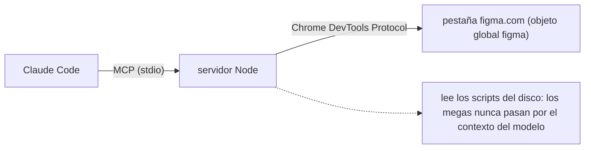

# Figma Control Center

[](https://github.com/velezanthony/figma-control-center/actions/workflows/ci.yml)


[](LICENSE)

**Un servidor MCP local que deja a Claude Code leer y modificar archivos de
Figma ejecutando scripts del API de plugins leídos del disco.** Sin el MCP
oficial, sin plugin y sin token de API.

Documentación (inglés y castellano): <https://velezanthony.github.io/figma-control-center/es/>
· [Read in English](README.md)



Las herramientas reciben **rutas de fichero**, no código. El servidor lee el
script, lo manda a la pestaña y deja en disco los resultados grandes: un script
de construcción de 5 MB le cuesta al modelo lo mismo que una línea.

## Primeros pasos

Necesitas Node **24+**, Google Chrome, Claude Code y una cuenta de Figma con
permiso de **edición** sobre el archivo. Los scripts de shell están pensados
para Linux.

```bash
make install     # dependencias
make login       # una vez: Chrome con ventana para iniciar sesión en Figma; ciérralo al acabar
make chrome      # Chrome sin ventana con el puerto de depuración y tu sesión de Figma
make dashboard   # http://127.0.0.1:4173 → Proyectos: da de alta tu archivo de Figma
claude           # en esta carpeta: aprueba el servidor «figma-control-center» de .mcp.json
```

Después pide a Claude `figma_status`: comprueba Chrome, la pestaña, el archivo
y la página, y dice el siguiente paso si falta algo. No hace falta `.env`:
cada ajuste tiene un valor por defecto.

[Instalación](docs/users/installation.es.md) →
[Claude Code](docs/users/claude-code.es.md) →
[herramientas MCP](docs/users/tools.es.md).

## Qué tienes

| | |
|---|---|
| **Scripts por ruta** | `figma_run_script` ejecuta un fichero —o un fragmento corto— con el API de plugins; los largos pasan a ser jobs |
| **Lotes** | `figma_build` ejecuta un manifiesto de pasos en segundo plano, reanudable, cancelable y protegido contra el archivo equivocado |
| **Lecturas a fichero** | variables, estilos, componentes, instancias, exportaciones y contexto de diseño van a disco; la respuesta es una ruta y un resumen |
| **Kit de Figma** | `figma-kit@1`, instalado en la pestaña y pasado a cada script: páginas y nodos por clave, componentes, instancias, tokens, iconos |
| **De la web a Figma** | captura las pantallas de un proyecto y pinta pantallas y hojas de componentes desde la captura |
| **De Figma a código** | `figma_design_context` describe un nodo con su auto-layout, sus tokens y las props de sus componentes |
| **Histórico** | cada llamada, job e intento en SQLite, consultable por agentes con las herramientas de solo lectura `figma_history_*` |
| **Panel** | un panel local con actividad, jobs, capturas, intentos, ajustes y un chat con una sesión de Claude Code restringida |

Los proyectos aportan sus datos con contratos versionados —JSON Schemas en
[`schemas/`](schemas/)—, así que el servidor no sabe nada de ningún proyecto
concreto.

## Documentación

- **Para usuarios**: [instalación](docs/users/installation.es.md),
  [Claude Code](docs/users/claude-code.es.md),
  [configuración](docs/users/configuration.es.md),
  [herramientas](docs/users/tools.es.md), [kit y pasos](docs/users/kit.es.md),
  [flujos](docs/users/workflows.es.md), [contratos](docs/users/contracts.es.md),
  [panel](docs/users/dashboard.es.md),
  [limitaciones conocidas](docs/users/limitations.es.md)
- **Para quien contribuye**: [visión general](docs/contributors/index.es.md),
  [CONTRIBUTING.es.md](CONTRIBUTING.es.md), [SECURITY.es.md](SECURITY.es.md),
  [CHANGELOG.md](CHANGELOG.md)

## Limitaciones

> [!WARNING]
> El servidor usa el objeto global `figma` que el editor web de Figma expone a
> una pestaña con permiso de edición. **No es un canal oficial de
> automatización** y puede cambiar sin aviso.

Un script en marcha no se puede interrumpir y la sesión de Figma del perfil de
Chrome caduca. La lista completa:
[limitaciones conocidas](docs/users/limitations.es.md).

## Apoyo

[](https://github.com/sponsors/velezanthony)

Si este proyecto te ahorra tiempo, plantéate [patrocinar su desarrollo](https://github.com/sponsors/velezanthony). Ayuda a mantenerlo vivo.

## Licencia

[MIT](LICENSE) © Anthony Velez Tapia
