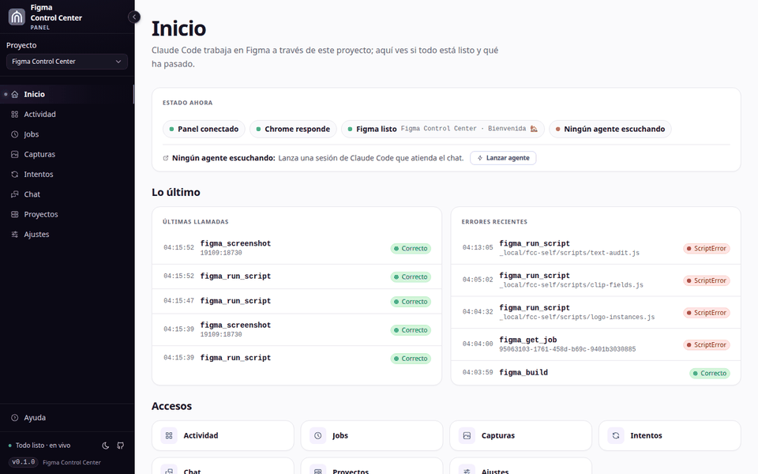
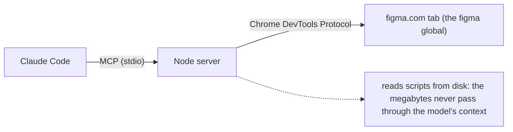

# Figma Control Center

[](https://github.com/velezanthony/figma-control-center/actions/workflows/ci.yml)


[](LICENSE)

**A local MCP server that lets Claude Code read and edit Figma files by running
Plugin API scripts from disk.** No official MCP, no plugin, no API token.

Docs (English and Spanish): <https://velezanthony.github.io/figma-control-center/>
· [Leer en castellano](README.es.md)

<p align="center">
  <picture>
    <source media="(prefers-color-scheme: dark)" srcset="docs/assets/dashboard/tour-dark.gif">
    
  </picture>
</p>



Tools receive **file paths**, not code. The server reads the script, sends it to
the tab and keeps big results on disk, so a 5 MB build script costs the model
the same as a one-liner.

## Getting started

Requires Node **24+**, Google Chrome, Claude Code and a Figma account with
**edit** permission on the file. The shell scripts target Linux.

```bash
make install     # dependencies
make login       # once: a Chrome window to sign in to Figma; close it when done
make chrome      # headless Chrome with the debugging port and your Figma session
make dashboard   # http://127.0.0.1:4173 → Projects: register your Figma file
claude           # in this folder: approve the "figma-control-center" server from .mcp.json
```

Then ask Claude for `figma_status`: it checks Chrome, the tab, the file and the
page, and names the next step if something is missing. No `.env` is needed —
every setting has a default.

[Installation](docs/users/installation.md) →
[Claude Code](docs/users/claude-code.md) →
[MCP tools](docs/users/tools.md).

## What you get

| | |
|---|---|
| **Scripts by path** | `figma_run_script` runs a script file — or a short snippet — with the Plugin API; long ones become jobs |
| **Batches** | `figma_build` runs a manifest of steps in the background, resumable, cancellable, guarded against the wrong file |
| **Reads to file** | variables, styles, components, instances, exports and design context land on disk; the answer is a path and a summary |
| **Figma kit** | `figma-kit@1`, installed in the tab and passed to every script: pages and nodes by key, components, instances, tokens, icons |
| **Web → Figma** | capture a project's screens, then paint screens and component sheets from the capture |
| **Figma → code** | `figma_design_context` describes a node with its auto-layout, tokens and component props |
| **History** | every call, job and attempt in SQLite, queryable by agents through read-only `figma_history_*` tools |
| **Dashboard** | a local panel with activity, jobs, captures, attempts, settings and a chat with a restricted Claude Code session |

Projects bring their data through versioned contracts — JSON Schemas in
[`schemas/`](schemas/) — so the server knows nothing about any one project.

## Documentation

- **For users** — [installation](docs/users/installation.md),
  [Claude Code](docs/users/claude-code.md),
  [configuration](docs/users/configuration.md), [tools](docs/users/tools.md),
  [kit and steps](docs/users/kit.md), [workflows](docs/users/workflows.md),
  [contracts](docs/users/contracts.md), [dashboard](docs/users/dashboard.md),
  [known limitations](docs/users/limitations.md)
- **For contributors** — [overview](docs/contributors/index.md),
  [CONTRIBUTING.md](CONTRIBUTING.md), [SECURITY.md](SECURITY.md),
  [CHANGELOG.md](CHANGELOG.md)

## Limitations

> [!WARNING]
> The server uses the `figma` global that the Figma web editor exposes to a tab
> with edit permission. **It is not an official automation channel** and can
> change without notice.

A running script cannot be interrupted and the Figma session in the Chrome
profile expires. The full list:
[known limitations](docs/users/limitations.md).

## Support

[](https://github.com/sponsors/velezanthony)

If this project saves you time, consider [sponsoring its development](https://github.com/sponsors/velezanthony). It helps keep it maintained.

## License

[MIT](LICENSE) © Anthony Velez Tapia
