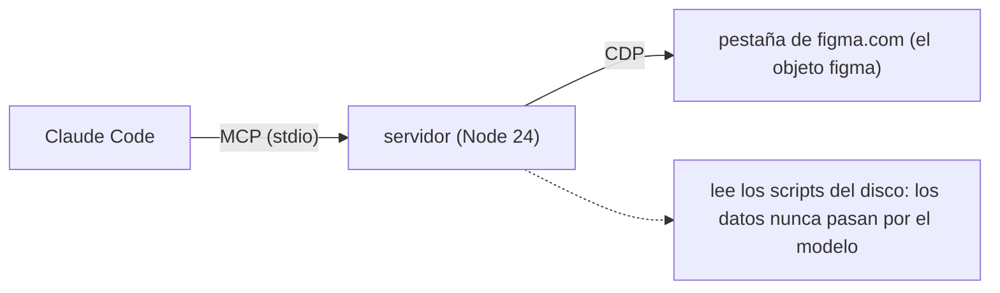

---
seo:
  title: "Arquitectura hexagonal sobre CDP"
  description: "Por qué Figma Control Center maneja una pestaña por CDP, sus capas hexagonales, el mapa de carpetas, la base SQLite compartida y cómo se vigilan las fronteras."
  image:
    src: "/og-es.png"
    alt: "Logo de Figma Control Center junto al lema: un servidor MCP local que ejecuta scripts del API de plugins desde disco"
---

# Arquitectura

## Por qué el servidor maneja una pestaña del navegador

Al API de plugins de Figma solo se llega desde dentro de Figma. Lo habitual es un plugin, pero Figma
en la web no carga un plugin de desarrollo desde un `manifest.json`, y no hay Figma Desktop oficial
para Linux. Lo que *sí* tiene el editor web es el objeto global `figma`, disponible para quien tiene
permiso de edición sobre el archivo abierto.

Así que el servidor se conecta a una pestaña de figma.com por el **Chrome DevTools Protocol** y
evalúa ahí los scripts:



> [!WARNING]
> El precio es que `figma` en una pestaña no es un canal oficial de automatización y puede cambiar sin
> aviso — está en las [limitaciones conocidas](../users/limitations.es.md).

## Capas

`server/src/` es hexagonal. Las dependencias apuntan hacia dentro y nada más:

| Capa | Carpeta | Puede importar |
|---|---|---|
| Dominio | `server/src/domain/` | nada — tipos y reglas puros, ni siquiera Node |
| Aplicación | `server/src/application/` | `domain`. Casos de uso y sus puertos en `application/ports/` |
| Adaptadores | `server/src/adapters/{cdp,config,contracts,fs,http,mcp,process,sqlite,web}/` | `domain` y `application` |
| Raíces de composición | `server/src/main.ts`, `dashboard.ts`, `agent-run.ts` y los ayudantes `compose-*.ts` | todo; el único sitio con `new` de adaptadores |

Los imports entre capas usan los alias declarados en el campo `imports` de `server/package.json`
(`#domain/…`, `#application/…`, `#adapters/…`), nunca `../../`. La web tiene los suyos
(`#web/…`). Node los resuelve de forma nativa, así que no hay un `paths` que mantener
sincronizado.

## Mapa de carpetas

```text
server/src/
  domain/          tipos y reglas puros: jobs, resultados, errores, actividad, contratos compartidos con la web
  application/     casos de uso (run-script, run-build, read-*, history, launch-agent…) y sus puertos
  adapters/
    cdp/           el gateway de Figma por Chrome DevTools Protocol
    web/           el Chrome aparte que captura la web del propio proyecto
    contracts/     esquemas zod de cada contrato publicado (origen de schemas/)
    config/        configuración: schema.ts (zod, valores por defecto) y env.ts (el único que lee process.env)
    fs/            scripts, resultados, manifiestos, locks, tokens del chat
    sqlite/        la base única: proyectos, ajustes, histórico, chat (Drizzle + better-sqlite3)
    mcp/           herramientas MCP, prompts y el canal del chat
    http/          la API HTTP del panel
    process/       lanzar la terminal para el lanzador del agente
  main.ts · dashboard.ts · agent-run.ts · compose-*.ts
server/test/       tests transversales: arquitectura, contratos, arnés, E2E herméticos, pruebas opcionales con Figma
kits/capture/      corre en la página web capturada (capture-kit)
kits/figma/        corre en la pestaña de Figma (figma-kit): piezas, steps/, screen/, sheet/, compose/, recognize/
kits/dist/         los paquetes versionados que inyecta el servidor
web/               el panel: Svelte 5 + Tailwind v4, compilado a web/dist
schemas/           JSON Schema publicado, generado desde adapters/contracts
spikes/            los scripts de shell de make chrome/login/probe y la guía del canal
```

Los tests unitarios van junto a su código; los sufijos están en [tests](testing.es.md).

## Dos procesos, una base

El servidor MCP y el panel son procesos distintos que comparten un fichero SQLite (`FCC_DB`, por
defecto `output/figma.db`, en modo WAL). Eso permite que el panel sobreviva a las sesiones de Claude
Code y muestre varias a la vez.

Qué puede cargar cada uno:

- `adapters/http/**` solo lo importa `dashboard.ts` (y `agent-run.ts`, para el cliente de vigilancia
  del panel en `panel-watch.ts`). El proceso MCP nunca debe cargar código que escriba en stdout.
- `dashboard.ts` nunca importa `adapters/cdp` ni `adapters/mcp`.
- Los contratos compartidos con la web viven en ficheros de `domain/` sin imports; la web los lee con
  `import type` solo a través de `web/src/lib/contract.ts`.
- Cada lado del chat tiene su raíz: el de la sesión se cablea en el proceso MCP y el del panel en
  `dashboard.ts`.
- Los kits no importan nada del servidor; `kits/figma/` solo toma los tipos del API de plugins con
  `import type`.

### Los proyectos son inquilinos

Toda tabla con datos de un proyecto lleva `project_id` (clave ajena con `ON DELETE CASCADE`, primera
en sus índices). Cada repositorio de `adapters/sqlite/` recibe el `projectId` al crearse y no tiene
ningún método sin él. Una consulta nueva sobre una tabla de proyecto va en uno de esos repositorios
acotados, con un test que use dos proyectos en la misma base. Las consultas del histórico son de solo
lectura: el puerto no tiene métodos que escriban y la conexión se abre con `queryOnly`.

## Contratos

Todo lo que cruza la frontera entre la herramienta y un proyecto consumidor — el manifiesto del lote,
`project@1`, `areas@1`, `map@1`, `sheets@1`, `compose@1`, `step@1`, `design-context@1`… — es un
esquema zod en `server/src/adapters/contracts/`. `npm run schemas` convierte cada uno en un JSON
Schema versionado en `schemas/`, y un test falla si el fichero versionado no coincide con el
`z.toJSONSchema` del esquema. Quien usa la herramienta los lee en la
[referencia de contratos](../users/contracts.es.md).

Las fronteras que el servidor *no* controla — respuestas de CDP, valores que devuelve Figma, el
canal de Claude Code — también tienen contratos zod, en `server/test/contracts/`. Los dobles de
prueba validan contra ellos todo lo que emiten, así que un simulador no puede acabar respondiendo lo
que Figma nunca respondería.

## Cómo se vigilan las fronteras

Nada de lo anterior es una convención que tengas que recordar; el build falla sin ella.

| Herramienta | Vigila | Dónde |
|---|---|---|
| ESLint | fronteras directas de import entre capas, procesos, capas atómicas de la web y kits; promesas sueltas | [`eslint.config.ts`](https://github.com/velezanthony/figma-control-center/blob/main/eslint.config.ts), rutas en [`eslint/architecture.ts`](https://github.com/velezanthony/figma-control-center/blob/main/eslint/architecture.ts) |
| dependency-cruiser | capas y alcanzabilidad, imports transitivos incluidos | [`.dependency-cruiser.mjs`](https://github.com/velezanthony/figma-control-center/blob/main/.dependency-cruiser.mjs) (mismas rutas que ESLint) |
| `architecture.test.ts` | histórico de solo lectura, lados del chat, acotado por inquilino, el panel nunca manda señales a procesos, las lecturas nunca escriben en Figma | [`server/test/architecture.test.ts`](https://github.com/velezanthony/figma-control-center/blob/main/server/test/architecture.test.ts) |
| `lint-rules.test.ts` | las propias reglas de ESLint, con casos que deben saltar y casos que no | [`server/test/lint-rules.test.ts`](https://github.com/velezanthony/figma-control-center/blob/main/server/test/lint-rules.test.ts) |
| tests de la web | ninguna clase de paleta ni color suelto fuera de `web/src/app.css`, contraste AA de los roles de color | `web/test/` |

ESLint no hace estilo — eso es cosa de Biome.
