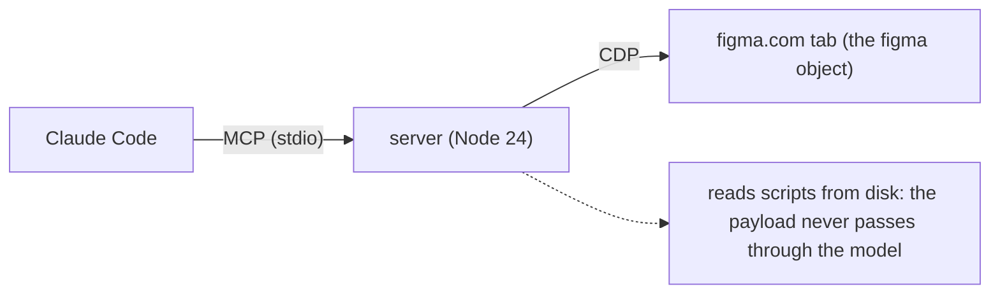

---
seo:
  title: "Hexagonal architecture over CDP"
  description: "Why Figma Control Center drives a browser tab over CDP, its hexagonal layers, folder map, shared SQLite database and how the boundaries are enforced."
---

# Architecture

## Why the server drives a browser tab

Figma's plugin API is only reachable from inside Figma. The usual way in is a plugin, but Figma on
the web cannot load a development plugin from a `manifest.json`, and there is no official Figma
Desktop for Linux. What the web editor *does* have is the global `figma` object, available to
anyone with edit rights on the open file.

So the server connects to a figma.com tab over the **Chrome DevTools Protocol** and evaluates
scripts there:



> [!WARNING]
> The cost is that `figma` in a tab is not an official automation channel and can change without
> notice — it is listed in the [known limitations](../users/limitations.md).

## Layers

`server/src/` is hexagonal. Dependencies point inwards and nothing else:

| Layer | Folder | May import |
|---|---|---|
| Domain | `server/src/domain/` | nothing — pure types and rules, not even Node |
| Application | `server/src/application/` | `domain`. Use cases plus their ports in `application/ports/` |
| Adapters | `server/src/adapters/{cdp,config,contracts,fs,http,mcp,process,sqlite,web}/` | `domain` and `application` |
| Composition roots | `server/src/main.ts`, `dashboard.ts`, `agent-run.ts` and the `compose-*.ts` helpers | everything; the only place with `new` for adapters |

Imports between layers use the aliases declared in the `imports` field of `server/package.json`
(`#domain/…`, `#application/…`, `#adapters/…`), never `../../`. The web has its
own (`#web/…`). Node resolves them natively, so there is no `paths` mapping to keep in
sync.

## Folder map

```text
server/src/
  domain/          pure types and rules: jobs, results, errors, activity, contracts shared with the web
  application/     use cases (run-script, run-build, read-*, history, launch-agent…) and their ports
  adapters/
    cdp/           the Figma gateway over Chrome DevTools Protocol
    web/           the separate Chrome that captures the project's own web
    contracts/     zod schemas of every published contract (source of schemas/)
    config/        configuration: schema.ts (zod, defaults) and env.ts (the only reader of process.env)
    fs/            scripts, results, manifests, locks, chat tokens
    sqlite/        the single database: projects, settings, history, chat (Drizzle + better-sqlite3)
    mcp/           MCP tools, prompts and the chat channel
    http/          the dashboard's HTTP API
    process/       spawning the terminal for the agent launcher
  main.ts · dashboard.ts · agent-run.ts · compose-*.ts
server/test/       cross-cutting tests: architecture, contracts, harness, hermetic E2E, opt-in Figma runs
kits/capture/      runs in the captured web page (capture-kit)
kits/figma/        runs in the Figma tab (figma-kit): pieces, steps/, screen/, sheet/, compose/, recognize/
kits/dist/         the committed bundles the server injects
web/               the dashboard: Svelte 5 + Tailwind v4, built to web/dist
schemas/           published JSON Schema, generated from adapters/contracts
spikes/            shell scripts behind make chrome/login/probe, and the channel guide
```

Unit tests sit next to their code; see [testing](testing.md) for the suffixes.

## Two processes, one database

The MCP server and the dashboard are separate processes that share one SQLite file (`FCC_DB`,
`output/figma.db` by default, in WAL mode). That is what lets the dashboard outlive Claude Code
sessions and show several of them at once.

What each may load:

- `adapters/http/**` is imported only by `dashboard.ts` (and `agent-run.ts`, for the panel watch
  client in `panel-watch.ts`). The MCP process must never load code that writes to stdout.
- `dashboard.ts` never imports `adapters/cdp` or `adapters/mcp`.
- Contracts shared with the web live in `domain/` files with no imports; the web reads them with
  `import type` through `web/src/lib/contract.ts` only.
- Each side of the chat has its own root: the session side is wired in the MCP process, the panel
  side in `dashboard.ts`.
- The kits import nothing from the server; `kits/figma/` only takes the plugin API types with
  `import type`.

### Projects are tenants

Every table holding project data carries `project_id` (a foreign key with `ON DELETE CASCADE`,
first in its indexes). Every repository in `adapters/sqlite/` receives the `projectId` when it is
created and has no method without it. A new query on a project table goes into one of those scoped
repositories, with a test that uses two projects in the same database. History queries are
read-only: the port has no write methods and the connection is opened `queryOnly`.

## Contracts

Everything that crosses a boundary between the tool and a consumer project — the build manifest,
`project@1`, `areas@1`, `map@1`, `sheets@1`, `compose@1`, `step@1`, `design-context@1`… — is a
zod schema in `server/src/adapters/contracts/`. `npm run schemas` turns each into a versioned JSON
Schema in `schemas/`, and a test fails if the committed file differs from `z.toJSONSchema` of the
schema. Users read them in the [contracts reference](../users/contracts.md).

The boundaries the server does *not* own — CDP replies, values coming back from Figma, the Claude
Code channel — have zod contracts too, in `server/test/contracts/`. The test doubles validate
everything they emit against them, so a simulator cannot drift into answering what Figma never
would.

## How the boundaries are enforced

None of the above is a convention you have to remember; the build fails without it.

| Tool | Guards | Where |
|---|---|---|
| ESLint | direct import boundaries between layers, processes, web atomic layers and kits; floating promises | [`eslint.config.ts`](https://github.com/velezanthony/figma-control-center/blob/main/eslint.config.ts), paths in [`eslint/architecture.ts`](https://github.com/velezanthony/figma-control-center/blob/main/eslint/architecture.ts) |
| dependency-cruiser | layers and reachability, including transitive imports | [`.dependency-cruiser.mjs`](https://github.com/velezanthony/figma-control-center/blob/main/.dependency-cruiser.mjs) (same paths as ESLint) |
| `architecture.test.ts` | read-only history, chat sides, tenant scoping, the dashboard never signalling processes, reads never writing to Figma | [`server/test/architecture.test.ts`](https://github.com/velezanthony/figma-control-center/blob/main/server/test/architecture.test.ts) |
| `lint-rules.test.ts` | the ESLint rules themselves, with cases that must and must not fire | [`server/test/lint-rules.test.ts`](https://github.com/velezanthony/figma-control-center/blob/main/server/test/lint-rules.test.ts) |
| web tests | no palette classes or loose colours outside `web/src/app.css`, AA contrast of the colour roles | `web/test/` |

ESLint does no styling — that is Biome's job.
