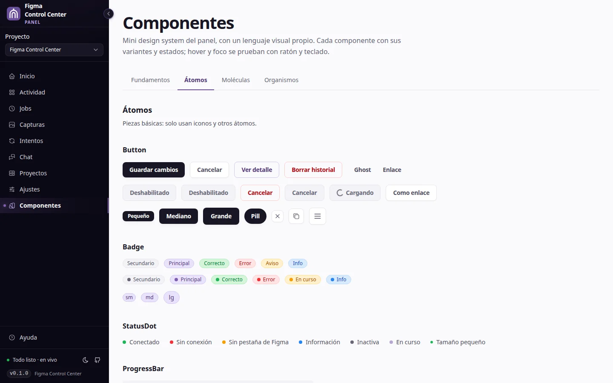

---
seo:
  title: "Entorno de desarrollo: make y npm"
  description: "Prepara Figma Control Center para desarrollar: los procesos y sus puntos de entrada, los comandos de make y npm y por dónde empezar a leer el código."
  image:
    src: "/og-es.png"
    alt: "Logo de Figma Control Center junto al lema: un servidor MCP local que ejecuta scripts del API de plugins desde disco"
---

# Desarrollo

## Preparar el entorno

```bash
make install      # npm ci
make e2e-setup    # una vez: el Chromium propio de Playwright, para los E2E herméticos
make check        # debería salir en verde antes de que cambies nada
```

Necesita Node **24** o posterior. Node ejecuta los `.ts` directamente: el servidor no se compila.
`better-sqlite3` trae binarios precompilados; su script de instalación implícito **no** se aprueba
(`allowScripts` está en `false`) y no hace falta.

> [!NOTE]
> Nada de la suite de tests necesita Chrome, Figma ni una sesión de Claude Code. Eso solo entra en
> juego cuando usas la herramienta de verdad — ver la [guía de usuario](../users/installation.es.md).

## Los procesos

Hay tres puntos de entrada, y cada uno es una raíz de composición: el único sitio de su proceso que
cablea los adaptadores concretos.

| Proceso | Punto de entrada | Qué es |
|---|---|---|
| Servidor MCP | [`server/src/main.ts`](https://github.com/velezanthony/figma-control-center/blob/main/server/src/main.ts) | Lo arranca Claude Code por **stdio** desde `.mcp.json`. Habla CDP con la pestaña de Figma |
| Panel | [`server/src/dashboard.ts`](https://github.com/velezanthony/figma-control-center/blob/main/server/src/dashboard.ts) | Servidor HTTP local para el panel de `web/`. Lee la misma base SQLite. Puede escribir en stdout |
| Lanzador del agente | [`server/src/agent-run.ts`](https://github.com/velezanthony/figma-control-center/blob/main/server/src/agent-run.ts) | Lo que ejecuta `make agent PROJECT=<id>`: arranca `claude` con el arnés del proyecto y limpia al terminar |

> [!NOTE]
> El servidor MCP y el panel nunca importan los adaptadores del otro. Por esa separación el panel
> sobrevive a un reinicio de Claude Code, y el proceso MCP no puede cargar código que escriba en
> stdout.

## Trabajar en cada parte

- **Servidor** — `make test-watch` y el ciclo de TDD de [tests](testing.es.md).
- **Interfaz del panel** — `make dashboard` en una terminal y `make dev-web` en otra: Vite con
  recarga en caliente, que pasa `/api`, `/events` y `/screenshots` al panel en marcha.
  `make test-watch-web` ejecuta el lado de Vitest. Con `FCC_DASHBOARD_MODE=development` en `.env`
  aparece la galería de componentes (`#/components`).
- **Kits** (`kits/capture/`, `kits/figma/`) — corren dentro de una página del navegador y se
  empaquetan en `kits/dist/`. Después de tocarlos, `npm run build:kit`: un test reconstruye el
  paquete en memoria y falla si el fichero versionado no corresponde a las fuentes.
- **Contratos** — tras cambiar un esquema zod de `server/src/adapters/contracts/`, `npm run schemas`
  regenera el JSON Schema publicado en `schemas/`. Un test compara los dos.
- **Base de datos** — tras cambiar `server/src/adapters/sqlite/schema.ts`, `npm run db:generate`
  escribe la migración de Drizzle.
- **Probar una herramienta a mano** — `make tools` lista las herramientas con la CLI del MCP
  Inspector; `make inspector` abre su interfaz contra `server/src/main.ts`.

La galería, en su pestaña Átomos:



## Los comandos

`make help` lista todos. Los que vas a usar:

| | |
|---|---|
| `make check` | typecheck + lint + test — antes de cada commit |
| `make verify` | `make check` + todos los E2E herméticos |
| `make typecheck` | `tsc` del servidor, el dominio, los kits y las herramientas de la web, más `svelte-check` |
| `make lint` | Biome, ESLint (fronteras y promesas) y dependency-cruiser, sin modificar ficheros |
| `make format` | Biome aplicando sus arreglos seguros |
| `make test` | `server/` con `node:test` y después `web/` con Vitest |
| `make test-watch` · `make test-watch-web` | Lo mismo, reejecutando al guardar |
| `make coverage` | Tests con cobertura |
| `make e2e-setup` · `make e2e` | El Chromium de Playwright, una vez · los E2E herméticos |
| `make e2e-record` · `make e2e-contract` · `make kit-contract` | Opcionales, contra el archivo de pruebas de Figma real — ver [tests](testing.es.md#contra-figma-real) |
| `make dashboard` · `make build-web` · `make dev-web` | Compilar y servir el panel · solo compilar · servidor de Vite |
| `make inspector` · `make tools` · `make mcp` | Interfaz del MCP Inspector · lista de herramientas · cómo ve Claude Code el servidor |
| `make chrome` · `make chrome-stop` · `make login` · `make probe` | El Chrome de depuración y una sonda rápida de lectura y escritura contra Figma |
| `npm run build:kit` | Reempaquetar `kits/dist/` |
| `npm run schemas` | Regenerar `schemas/` desde zod |
| `npm run db:generate` | Migración de Drizzle tras cambiar el esquema |

## Por dónde empezar a leer

[`server/src/main.ts`](https://github.com/velezanthony/figma-control-center/blob/main/server/src/main.ts)
es cableado y nada más, repartido en los ayudantes `server/src/compose-*.ts` que llama:
[`compose-tenant.ts`](https://github.com/velezanthony/figma-control-center/blob/main/server/src/compose-tenant.ts)
monta el plano de datos de un proyecto (gateway de CDP, adaptadores de disco, base) y
[`compose-session.ts`](https://github.com/velezanthony/figma-control-center/blob/main/server/src/compose-session.ts)
monta la sesión encima.

Después sigue una herramienta:
[`adapters/mcp/tools.ts`](https://github.com/velezanthony/figma-control-center/blob/main/server/src/adapters/mcp/tools.ts)
registra `figma_run_script`, que llama a
[`application/run-script.ts`](https://github.com/velezanthony/figma-control-center/blob/main/server/src/application/run-script.ts),
que habla con el puerto `FigmaGateway` implementado en
[`adapters/cdp/`](https://github.com/velezanthony/figma-control-center/tree/main/server/src/adapters/cdp).
Ese camino — adaptador, caso de uso, puerto, adaptador — es la forma de cualquier funcionalidad.
[Arquitectura](architecture.es.md) tiene el mapa.
