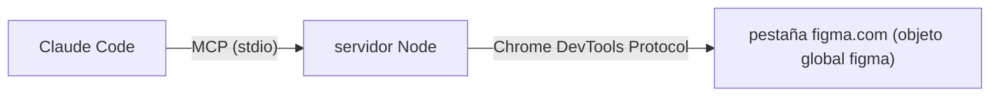

---
seo:
  title: "Figma Control Center: servidor MCP para Claude Code"
  titleSuffix: false
  description: "Figma Control Center es un servidor MCP local que deja a Claude Code leer y editar archivos de Figma con scripts del API de plugins leídos del disco."
  image:
    src: "/og-es.png"
    alt: "Logo de Figma Control Center junto al lema: un servidor MCP local que ejecuta scripts del API de plugins desde disco"
---

# Figma Control Center

**Un servidor MCP local que deja a Claude Code leer y modificar archivos de
Figma ejecutando scripts del API de plugins leídos del disco.** Sin el MCP
oficial, sin plugin y sin token de API.

Las herramientas reciben **rutas de fichero**, no código. El servidor lee el
script, lo manda a la pestaña y deja en disco los resultados grandes: los megas
nunca pasan por el contexto del modelo.

**Por dónde empezar:** [instálalo](users/installation.es.md) y después [mira las herramientas](users/tools.es.md).

## Qué hay dentro

- **Scripts y lotes.** Ejecuta un script por su ruta, o un manifiesto de pasos en segundo plano:
  reanudable, cancelable y protegido contra el archivo equivocado. Ver
  [Herramientas MCP](users/tools.es.md).
- **Un kit dentro de la pestaña.** `figma-kit@1` se instala una vez por pestaña y llega a cada
  script: páginas y nodos por clave, componentes, instancias, tokens e iconos. Ver
  [Kit y pasos](users/kit.es.md).
- **Web ↔ Figma.** Captura las pantallas de un proyecto y píntalas en Figma; describe un nodo de
  Figma para llevarlo a código; diseña una pantalla sin web. Ver [Flujos](users/workflows.es.md).
- **Un histórico que leen los agentes.** Cada llamada, job e intento en SQLite, por proyecto, con
  herramientas de solo lectura y un panel local. Ver [Panel](users/dashboard.es.md).

## Principios

- **Rutas, no contenidos.** Ninguna herramienta necesita que el modelo cargue
  con un script o un resultado: los dos viven en disco.
- **Genérico.** El servidor no conoce ningún proyecto. Los proyectos aportan
  sus datos con [contratos](users/contracts.es.md) versionados.
- **Cada fallo dice el siguiente paso.** Los errores dicen si tiene sentido
  reintentar (`retryable`) y qué hacer (`nextStep`).
- **Los límites están escritos.** La página de
  [limitaciones conocidas](users/limitations.es.md) es parte del contrato, empezando
  por que el objeto `figma` de la pestaña no es un canal oficial de
  automatización.

::nav-tree
