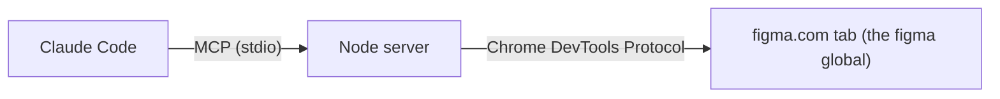
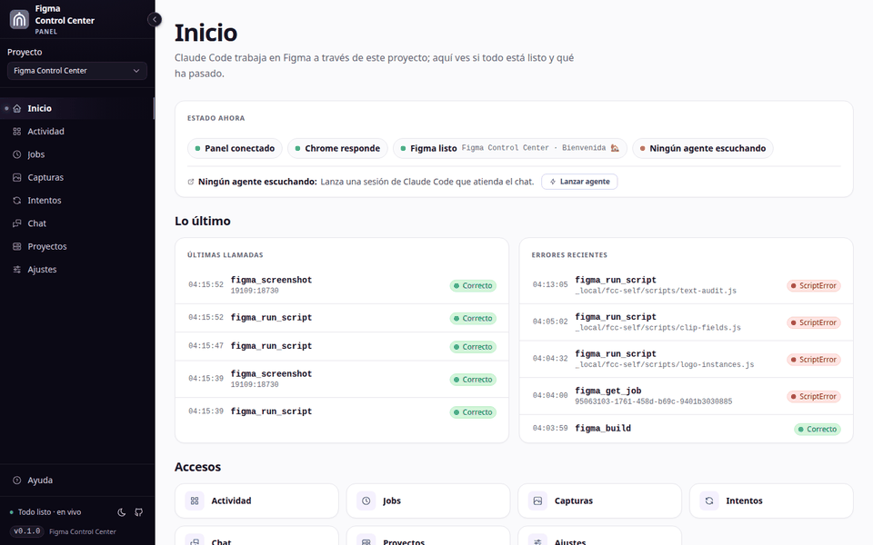

---
seo:
  title: "Figma Control Center: MCP server for Claude Code"
  titleSuffix: false
  description: "Figma Control Center is a local MCP server that lets Claude Code read and edit Figma files by running Plugin API scripts from disk over CDP."
---

# Figma Control Center

**A local MCP server that lets Claude Code read and edit Figma files by running
Plugin API scripts from disk.** No official MCP, no plugin, no API token.

Tools receive **file paths**, not code. The server reads the script, sends it to
the tab and keeps big results on disk: the megabytes never pass through the
model's context.

Everything the server does shows up, live, in a local dashboard:

**Start here:** [install it](users/installation.md), then [see the tools](users/tools.md).

## What's inside

- **Scripts and batches.** Run one script by path, or a manifest of steps in the background:
  resumable, cancellable, guarded against the wrong file. See [MCP tools](users/tools.md).
- **A kit inside the tab.** `figma-kit@1` is installed once per tab and handed to every script:
  pages and nodes by key, components, instances, tokens and icons. See [Kit and steps](users/kit.md).
- **Web ↔ Figma.** Capture a project's screens and paint them in Figma; describe a Figma node for
  code; design a screen without a web. See [Workflows](users/workflows.md).
- **A history agents can read.** Every call, job and attempt in SQLite, per project, with read-only
  tools and a local dashboard. See [Dashboard](users/dashboard.md).

## Principles

- **Paths, not payloads.** A tool never needs the model to carry a script or a
  result; both live on disk.
- **Generic.** The server knows no project. Projects bring their data through
  versioned [contracts](users/contracts.md).
- **Every failure names the next step.** Errors say whether retrying makes
  sense (`retryable`) and what to do (`nextStep`).
- **Limits are written down.** The [known limitations](users/limitations.md)
  page is part of the contract — starting with the fact that the `figma`
  global in the tab is not an official automation channel.

::nav-tree
