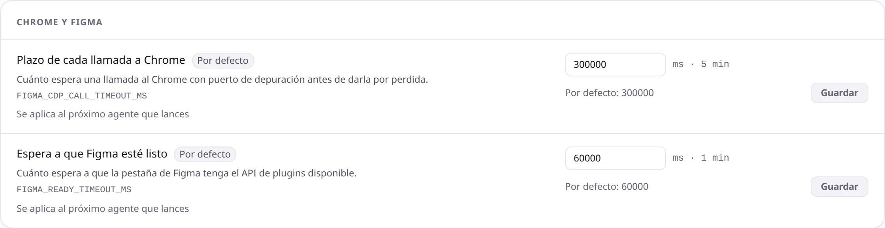

---
seo:
  title: "Configura el servidor MCP de Figma"
  description: "Configura Figma Control Center: variables de la máquina en .env, ajustes editables en el panel, proyectos y el fichero JSON del proyecto consumidor."
  image:
    src: "/og-es.png"
    alt: "Logo de Figma Control Center junto al lema: un servidor MCP local que ejecuta scripts del API de plugins desde disco"
---

# Configuración

La configuración vive en tres sitios, y cada uno responde a una pregunta distinta:

| Dónde | Qué | Quién lo cambia |
|---|---|---|
| Entorno / `.env` | Cómo lo ejecuta esta **máquina**: puertos, rutas, plazos, topes | Tú, y después un reinicio |
| La página **Ajustes** (`#/settings`) | El subconjunto *editable* de esas variables, guardado en la base | El panel |
| La página **Proyectos** (`#/projects`) + `figma-control-center.json` | Qué archivo de Figma, qué carpetas y cómo se captura la web de cada **proyecto** | El panel y los propios ficheros del proyecto consumidor |

## Ajustes de la máquina

Todas las variables tienen valor por defecto; ninguna es obligatoria. El esquema vive en
`server/src/adapters/config/schema.ts` y se valida al arrancar: un valor inválido detiene el servidor o
el panel con un mensaje que lo nombra. Las rutas admiten `~/…`, rutas relativas a la raíz del
repositorio o rutas absolutas. Las variables de Figma o del Chrome que lo tiene abierto empiezan por
`FIGMA_`; los ajustes propios de la herramienta, por `FCC_`.

Cada variable es de uno de dos tipos:

- **Editable** (`EDITABLE_KEYS`): plazos, topes e intervalos de sondeo. La página **Ajustes** enseña
  cada una con su ayuda, su unidad, su valor por defecto y de dónde sale el valor actual. La
  precedencia es *por defecto < guardado en el panel < entorno*: una variable que fija tu entorno sale
  ahí en solo lectura, y para editarla en el panel tienes que quitarla del `.env` y reiniciar. Un
  cambio vale para el siguiente agente o sesión de Claude Code que arranque, y para el panel cuando se
  reinicie; nada se recarga en caliente.
- **De arranque** (`BOOT_KEYS`): puertos, rutas, la base, la orden de la terminal, el alcance de
  acceso. Solo las fija el entorno, porque sin ellas no se puede abrir nada, o porque son una ruta,
  una orden o un permiso que un ajuste guardado no debería poder cambiar.

Las tablas dicen para qué sirve cada variable; los valores por defecto de las editables están en la
página Ajustes.

### Chrome y Figma

| Variable | Tipo | Para qué |
|---|---|---|
| `FIGMA_CDP_HOST` · `FIGMA_CDP_PORT` | arranque | Dónde escucha el Chrome de depuración |
| `FIGMA_CHROME_PROFILE` | arranque | Perfil de ese Chrome (por defecto `~/.cache/figma-control-center-chrome`); se rechaza si cae dentro del repositorio |
| `FIGMA_CHROME_SEED_PROFILE` | arranque | Perfil opcional del que copiar la sesión la primera vez |
| `FIGMA_CDP_CALL_TIMEOUT_MS` | editable | Tiempo máximo de una llamada a Chrome |
| `FIGMA_READY_TIMEOUT_MS` | editable | Cuánto esperar a que el editor exponga el API de plugins |

### Scripts y lotes

| Variable | Tipo | Para qué |
|---|---|---|
| `FCC_SCRIPTS_ROOT` | arranque | Carpetas de las que se pueden leer scripts cuando un proyecto no declara ninguna (varias, separadas por `:`) |
| `FCC_OUTPUT_DIR` | arranque | Carpeta base de capturas, lecturas y resultados grandes |
| `FCC_LOCK_DIR` | arranque | Carpeta de la máquina con un fichero de bloqueo por archivo de Figma, para que dos sesiones nunca lancen un lote sobre el mismo archivo (por defecto `~/.cache/figma-control-center-locks`) |
| `FCC_SOFT_DEADLINE_MS` | editable | Cuánto espera una herramienta antes de responder `running` con un `jobId` |
| `FCC_MAX_INLINE_RESULT_BYTES` | editable | El `result` más grande que se devuelve en la respuesta; por encima, va a disco |
| `FCC_ACTIVITY_CODE_PREVIEW_CHARS` | editable | Cuánto de un `code` suelto guarda el histórico como vista previa |
| `FCC_BUILD_MAX_STEPS` · `FCC_BUILD_STEP_TIMEOUT_MS` | editable | Pasos por lote y plazo de cada paso |
| `FCC_PROGRESS_MIN_INTERVAL_MS` | editable | Intervalo mínimo entre avisos de progreso de un lote |
| `FCC_MAX_PARAMS_BYTES` · `FCC_MAX_ASSET_BYTES` | editable | Topes de tamaño de `params` y `assets` |
| `FIGMA_EXPORT_MAX_NODES` | editable | Nodos por llamada a `figma_export` |
| `FIGMA_DESIGN_CONTEXT_MAX_NODES` | editable | Nodos por lectura de `figma_design_context` |

### Histórico y base

| Variable | Tipo | Para qué |
|---|---|---|
| `FCC_DB` | arranque | La base SQLite única: proyectos, ajustes y el histórico de todos los proyectos (por defecto `output/figma.db`) |
| `FCC_HISTORY_RETENTION_DAYS` | editable | Días que se conserva el histórico (el último intento correcto de cada objetivo se queda) |
| `FCC_HISTORY_MAX_ROWS` | editable | Tope de filas por consulta del histórico (`truncated` dice cuándo se alcanzó) |
| `FCC_HISTORY_STEP_EXCERPT_BYTES` | editable | Extracto de cada paso de un lote que devuelve `figma_history_call` |
| `FCC_HISTORY_DIFF_INLINE_LINES` | editable | Líneas de diff que devuelve `figma_history_diff` en la respuesta |
| `FCC_SCRIPT_MAX_BYTES` | editable | El contenido más grande que se guarda de un intento; por encima, solo su hash y su tamaño |

### Panel y agente

| Variable | Tipo | Para qué |
|---|---|---|
| `FCC_DASHBOARD_HOST` · `FCC_DASHBOARD_PORT` | arranque | Dónde escucha el panel. Solo local: `127.0.0.1`, `localhost` o `::1` |
| `FCC_DASHBOARD_HISTORY` | editable | Eventos que se reenvían a quien se reconecta |
| `FCC_DASHBOARD_MODE` | arranque | `production` (por defecto) o `development`. En desarrollo la barra lateral, Inicio y Ayuda añaden **Componentes**, la galería de la propia interfaz del panel; en producción no aparece y `#/components` abre el inicio |
| `FCC_LIVE_POLL_MS` · `FCC_CHAT_POLL_MS` | editable | Cada cuánto mira el panel si hay eventos nuevos, y el agente si hay mensajes del chat |
| `FCC_AGENT_TERMINAL` | arranque | Orden que abre una terminal para **Lanzar agente**, partida por espacios y ejecutada sin shell (por defecto `gnome-terminal --`) |
| `FCC_AGENT_LAUNCH_TIMEOUT_MS` | editable | Cuánto espera el panel a que la sesión lanzada publique su chat |
| `FCC_AGENT_PANEL_GRACE_MS` · `FCC_AGENT_WATCH_RETRY_MS` | editable | Cuánto espera un agente lanzado a que vuelva el panel antes de cerrarse, y cada cuánto reintenta |
| `FCC_PROJECTS` | arranque | El alcance de acceso del servidor MCP: `any` o números de proyecto separados por comas (ver [Usarlo desde Claude Code](claude-code.es.md#el-proyecto-que-atiende-el-servidor)) |

### Captura de la web

| Variable | Tipo | Para qué |
|---|---|---|
| `FCC_WEB_CHROME_BIN` · `FCC_WEB_CHROME_PORT` · `FCC_WEB_CHROME_PROFILE_DIR` | arranque | El Chrome sin ventana, aparte, con el que se captura la web: nunca el de Figma |
| `FCC_WEB_SECRETS_FILE` | arranque | Fichero de la máquina con las contraseñas de los usuarios de captura, `{ "<secretRef>": "<valor>" }` (por defecto `~/.config/figma-control-center/secrets.json`). Tenlo fuera de todo repositorio |
| `FCC_WEB_PAGE_TIMEOUT_MS` | editable | Espera de cada página capturada |
| `FCC_CAPTURE_MAX_BYTES` | editable | La captura más grande que se acepta |
| `FCC_CONTRACT_INLINE_ERRORS` | editable | Errores de contrato que se devuelven en la respuesta; el resto va al fichero de errores |

### Solo para tests

`FIGMA_TEST_FILE_URL` (el archivo de Figma reservado para las pruebas opcionales contra Figma real) y
`FCC_E2E` los lee la suite de tests; ver [Tests](../contributors/testing.es.md). Las variables que
solo usa el arnés de tests no salen aquí.

Un grupo de la página de Ajustes:



## Proyectos

Un proyecto es un archivo de Figma más las carpetas que las herramientas pueden tocar para él. Se da
de alta en la página **Proyectos** (ver [Instalación](installation.es.md#da-de-alta-tu-archivo-de-figma))
y se guarda en la base, que le da un número.

| Campo | Para qué |
|---|---|
| Archivo de Figma | La pestaña que abre el servidor y con la que habla |
| Directorio del proyecto | De dónde se leen `figma-control-center.json` y los ficheros de contrato |
| Raíces de scripts | Las únicas carpetas de las que `figma_run_script` y `figma_build` leen scripts y assets (por defecto, `FCC_SCRIPTS_ROOT`) |
| Carpeta de salida | Todo lo que escriben las herramientas para este proyecto (por defecto `output/<número>`) |

### Qué cae en la carpeta de salida

| Subcarpeta | La escribe |
|---|---|
| `screenshots/<AAAA-MM-DD>/` | Las capturas de `figma_screenshot` y de `figma_design_context`. El panel enseña también las de una carpeta `capturas/<AAAA-MM-DD>/` anterior |
| `reads/` | Las lecturas del catálogo y `figma_design_context` |
| `exports/` | `figma_export` |
| `results/` | Los `result` demasiado grandes para la respuesta, y `resultFile` |
| `web-captures/<día>/` · `rejected/` | `figma_capture`: las capturas válidas, y las que no cumplen `capture@1` con sus errores |
| `screen-plans/` · `sheet-plans/` | Los planes `screen@1` y `component@1` que arma el servidor para los pasos del kit |
| `history-scripts/` · `history-diffs/` | `figma_history_script` y `figma_history_diff` |

## El proyecto consumidor: `figma-control-center.json`

Capturar una web, construir pantallas desde ella o diseñar sin ella exige saber cosas del proyecto
que se diseña. Ese conocimiento vive **en la carpeta de ese proyecto**, como datos, en ficheros que la
herramienta valida contra contratos publicados (ver [Contratos](contracts.es.md)). Nada le pide al
proyecto que añada marcas a su HTML: todo se deduce de lo que la web ya pinta.

La entrada es `figma-control-center.json` (`project@1`) en el directorio del proyecto. Describe la web
y apunta a los demás ficheros, con rutas relativas a él:

```json
{
  "contract": "project@1",
  "web": {
    "baseUrl": "http://127.0.0.1:8000",
    "viewport": { "w": 1440, "h": 900 },
    "login": {
      "path": "/login/",
      "fields": { "user": "#username", "password": "#password" }
    },
    "users": {
      "reader": { "username": "reader", "secretRef": "ejemplo-reader" }
    },
    "strip": [".cookie-banner"],
    "hideScrollbar": true
  },
  "screens": "screens.json",
  "hooks": "hooks.js",
  "areas": "areas.json",
  "map": "map.json",
  "recognize": "recognize.js",
  "sheets": "sheets.json",
  "compose": "compose/"
}
```

> [!IMPORTANT]
> Solo `contract`, `web` y `screens` son obligatorios. La contraseña de cada usuario de captura nunca está
> en el proyecto: `secretRef` nombra una entrada de `FCC_WEB_SECRETS_FILE`.

| Fichero | Contrato | Qué guarda | Hace falta para |
|---|---|---|---|
| `screens.json` | `screens@1` | Qué páginas se capturan, en qué URL, con qué variantes e interacciones | `figma_capture` |
| `hooks.js` | ganchos de `capture@1` | Código opcional durante la captura: `prepare` (una vez, p. ej. aceptar el aviso de cookies), `ready` (cuándo está lista la app), `ignore` (elementos que se saltan) | `figma_capture` |
| `areas.json` | `areas@1` | Las áreas del archivo de Figma: página, tamaño del frame, cómo se coloca una pantalla construida, partes compartidas, enlaces del prototipo, rellenos de imagen | `figma_build` con `areas` y los pasos de área del kit |
| `map.json` | `map@1` | Cómo pasa el código a Figma: prefijos de clase a variables, fuentes, efectos, iconos, nombres de capa, huellas de componentes | `kit/build-screen@1`, `kit/build-component@1`, `figma_design_context` |
| `icons.json` | — | El catálogo de iconos al que apunta `map@1`: `[{ "name", "svg" }]` | Iconos en pantallas y en `compose@1` |
| `fingerprints.json` | — | Las huellas de componentes a las que apunta `map@1`, para reconocer componentes en una captura | El reconocimiento de `kit/build-screen@1` |
| `recognize.js` | `recognize@1` | Reglas opcionales del proyecto que convierten un nodo capturado en una instancia de un set, con su variante y sus props | `kit/build-screen@1`, `kit/build-component@1` |
| `sheets.json` | `sheets@1` | Una hoja por componente: qué pantalla capturada lo muestra, su matriz de variantes, sus textos y la plantilla de la que sale | `figma_build` con `sheets`, `figma_design_context` |
| `compose/<clave>.json` | `compose@1` | Una pantalla diseñada en Figma sin web detrás | `kit/compose@1` |

> [!NOTE]
> `hooks.js` y `recognize.js` son **código del proyecto consumidor**: el servidor nunca los ejecuta. Los
> ganchos de captura corren en el Chrome de captura; las reglas de reconocimiento, en la pestaña de
> Figma.

> [!TIP]
> El fixture de tests `server/test/fixtures/projects/example-mini/` es un proyecto consumidor completo
> y pequeño con todos estos ficheros; es la mejor referencia de su forma.
