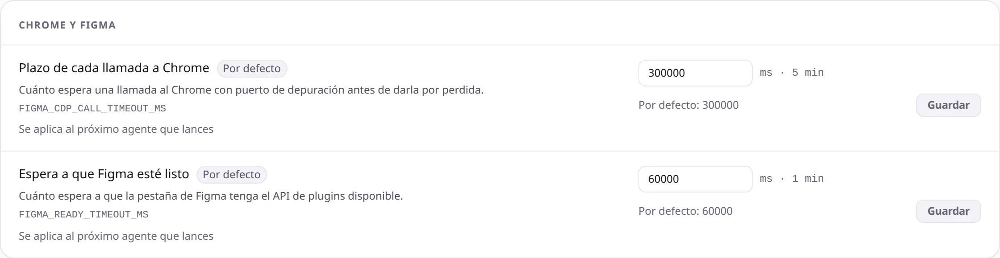

---
seo:
  title: "Configure the Figma MCP server"
  description: "Configure Figma Control Center: machine variables in .env, editable settings in the dashboard, projects, and the consumer project's JSON file."
---

# Configuration

Three places hold configuration, and each answers a different question:

| Where | What | Changed by |
|---|---|---|
| Environment / `.env` | How this **machine** runs it: ports, paths, timeouts, limits | You, then a restart |
| The **Settings** page (`#/settings`) | The *editable* subset of those variables, stored in the database | The dashboard |
| The **Projects** page (`#/projects`) + `figma-control-center.json` | Which Figma file, which folders, and how to capture the web of each **project** | The dashboard and the consumer project's own files |

## Machine settings

Every variable has a default; nothing is mandatory. The schema lives in
`server/src/adapters/config/schema.ts` and is validated at start-up: an invalid value stops the
server or the dashboard with a message naming it. Paths accept `~/…`, paths relative to the
repository root, or absolute paths. Variables about Figma or the Chrome that has it open start with
`FIGMA_`; the tool's own settings start with `FCC_`.

Each variable is one of two kinds:

- **Editable** (`EDITABLE_KEYS`): timeouts, limits and polling intervals. The **Settings** page lists
  each one with its help text, unit, default, and where the current value comes from. Precedence is
  *default < saved in the dashboard < environment*: a variable your environment sets appears
  read-only there, and you have to remove it from the `.env` and restart to edit it in the dashboard.
  A change applies to the next agent or Claude Code session that starts, and to the dashboard when it
  restarts; nothing reloads live.
- **Boot** (`BOOT_KEYS`): ports, paths, the database, the terminal command, the access scope. Only
  the environment sets them, because without them nothing can open — or because they are a path, a
  command or a permission that a stored setting should not be able to change.

The tables below give what each variable is for; the defaults of the editable ones are on the
Settings page.

### Chrome and Figma

| Variable | Kind | For |
|---|---|---|
| `FIGMA_CDP_HOST` · `FIGMA_CDP_PORT` | boot | Where the debug Chrome listens |
| `FIGMA_CHROME_PROFILE` | boot | Profile of that Chrome (default `~/.cache/figma-control-center-chrome`); rejected if inside the repository |
| `FIGMA_CHROME_SEED_PROFILE` | boot | Optional profile to copy the session from the first time |
| `FIGMA_CDP_CALL_TIMEOUT_MS` | editable | Maximum time of one call to Chrome |
| `FIGMA_READY_TIMEOUT_MS` | editable | How long to wait for the editor to expose the plugin API |

### Scripts and batches

| Variable | Kind | For |
|---|---|---|
| `FCC_SCRIPTS_ROOT` | boot | Folders scripts may be read from when a project declares none (several, separated by `:`) |
| `FCC_OUTPUT_DIR` | boot | Base folder for screenshots, reads and large results |
| `FCC_LOCK_DIR` | boot | Machine-wide folder with one lock file per Figma file, so two sessions never run a batch on the same file (default `~/.cache/figma-control-center-locks`) |
| `FCC_SOFT_DEADLINE_MS` | editable | How long a tool waits before answering `running` with a `jobId` |
| `FCC_MAX_INLINE_RESULT_BYTES` | editable | Largest `result` returned inline; beyond it, it is written to disk |
| `FCC_ACTIVITY_CODE_PREVIEW_CHARS` | editable | How much of an inline `code` the history keeps as a preview |
| `FCC_BUILD_MAX_STEPS` · `FCC_BUILD_STEP_TIMEOUT_MS` | editable | Steps per batch and timeout of each step |
| `FCC_PROGRESS_MIN_INTERVAL_MS` | editable | Minimum interval between progress notifications of a batch |
| `FCC_MAX_PARAMS_BYTES` · `FCC_MAX_ASSET_BYTES` | editable | Size caps for `params` and `assets` |
| `FIGMA_EXPORT_MAX_NODES` | editable | Nodes per `figma_export` call |
| `FIGMA_DESIGN_CONTEXT_MAX_NODES` | editable | Nodes per `figma_design_context` read |

### History and database

| Variable | Kind | For |
|---|---|---|
| `FCC_DB` | boot | The single SQLite database: projects, settings and every project's history (default `output/figma.db`) |
| `FCC_HISTORY_RETENTION_DAYS` | editable | Days of history kept (the last successful attempt of each target survives) |
| `FCC_HISTORY_MAX_ROWS` | editable | Row cap per history query (`truncated` says when it hit) |
| `FCC_HISTORY_STEP_EXCERPT_BYTES` | editable | Excerpt of each batch step that `figma_history_call` returns |
| `FCC_HISTORY_DIFF_INLINE_LINES` | editable | Diff lines returned inline by `figma_history_diff` |
| `FCC_SCRIPT_MAX_BYTES` | editable | Largest content stored for an attempt; above it only its hash and size are kept |

### Dashboard and agent

| Variable | Kind | For |
|---|---|---|
| `FCC_DASHBOARD_HOST` · `FCC_DASHBOARD_PORT` | boot | Where the dashboard listens. Loopback only: `127.0.0.1`, `localhost` or `::1` |
| `FCC_DASHBOARD_HISTORY` | editable | Events replayed to a client that reconnects |
| `FCC_DASHBOARD_MODE` | boot | `production` (default) or `development`. Development adds **Components**, the gallery of the dashboard's own UI, to the sidebar, Home and Help; in production it does not appear and `#/components` opens Home |
| `FCC_LIVE_POLL_MS` · `FCC_CHAT_POLL_MS` | editable | How often the dashboard looks for new events, and the agent for chat messages |
| `FCC_AGENT_TERMINAL` | boot | Command that opens a terminal for **Launch agent**, split on spaces and run without a shell (default `gnome-terminal --`) |
| `FCC_AGENT_LAUNCH_TIMEOUT_MS` | editable | How long the dashboard waits for a launched session to publish its chat |
| `FCC_AGENT_PANEL_GRACE_MS` · `FCC_AGENT_WATCH_RETRY_MS` | editable | How long a launched agent waits for the dashboard to come back before closing, and how often it retries |
| `FCC_PROJECTS` | boot | The MCP server's access scope: `any` or project numbers separated by commas (see [Use it from Claude Code](claude-code.md#which-project-the-server-serves)) |

### Web capture

| Variable | Kind | For |
|---|---|---|
| `FCC_WEB_CHROME_BIN` · `FCC_WEB_CHROME_PORT` · `FCC_WEB_CHROME_PROFILE_DIR` | boot | The separate headless Chrome used to capture the web — never the Figma one |
| `FCC_WEB_SECRETS_FILE` | boot | Machine file with the passwords of capture users, `{ "<secretRef>": "<value>" }` (default `~/.config/figma-control-center/secrets.json`). Keep it outside every repository |
| `FCC_WEB_PAGE_TIMEOUT_MS` | editable | Wait for each captured page |
| `FCC_CAPTURE_MAX_BYTES` | editable | Largest capture accepted |
| `FCC_CONTRACT_INLINE_ERRORS` | editable | Contract errors returned inline; the rest go to the errors file |

### Tests only

`FIGMA_TEST_FILE_URL` (the Figma file reserved for opt-in tests against real Figma) and `FCC_E2E`
are read by the test suite; see [Testing](../contributors/testing.md). Variables used only inside the
test harness are not listed here.

One group of the Settings page:



## Projects

A project is one Figma file plus the folders the tools may touch for it. It is registered on the
**Projects** page (see [Installation](installation.md#register-your-figma-file)) and stored in the
database, which gives it a number.

| Field | Used for |
|---|---|
| Figma file | The tab the server opens and talks to |
| Project directory | Where `figma-control-center.json` and the contract files are read from |
| Scripts roots | The only folders `figma_run_script` and `figma_build` read scripts and assets from (default: `FCC_SCRIPTS_ROOT`) |
| Output folder | Everything the tools write for this project (default `output/<number>`) |

### What lands in the output folder

| Subfolder | Written by |
|---|---|
| `screenshots/<YYYY-MM-DD>/` | `figma_screenshot` and `figma_design_context` screenshots. The dashboard also shows the ones in an older `capturas/<YYYY-MM-DD>/` |
| `reads/` | The catalog reads and `figma_design_context` |
| `exports/` | `figma_export` |
| `results/` | `result` values too large to return inline, and `resultFile` |
| `web-captures/<day>/` · `rejected/` | `figma_capture`: valid captures, and those that fail `capture@1` with their errors |
| `screen-plans/` · `sheet-plans/` | The `screen@1` and `component@1` plans the server builds for the kit steps |
| `history-scripts/` · `history-diffs/` | `figma_history_script` and `figma_history_diff` |

## The consumer project: `figma-control-center.json`

Capturing a web, building screens from it or designing without one needs to know about the project
being designed. That knowledge lives **in that project's folder**, as data, in files the tool
validates against published contracts (see [Contracts](contracts.md)). Nothing asks the project to add
markers to its HTML: everything is inferred from what the web already renders.

The entry point is `figma-control-center.json` (`project@1`) in the project directory. It describes
the web and points to the other files, with paths relative to itself:

```json
{
  "contract": "project@1",
  "web": {
    "baseUrl": "http://127.0.0.1:8000",
    "viewport": { "w": 1440, "h": 900 },
    "login": {
      "path": "/login/",
      "fields": { "user": "#username", "password": "#password" }
    },
    "users": {
      "reader": { "username": "reader", "secretRef": "ejemplo-reader" }
    },
    "strip": [".cookie-banner"],
    "hideScrollbar": true
  },
  "screens": "screens.json",
  "hooks": "hooks.js",
  "areas": "areas.json",
  "map": "map.json",
  "recognize": "recognize.js",
  "sheets": "sheets.json",
  "compose": "compose/"
}
```

> [!IMPORTANT]
> Only `contract`, `web` and `screens` are required. The password of each capture user is never in the
> project: `secretRef` names an entry of `FCC_WEB_SECRETS_FILE`.

| File | Contract | What it holds | Needed for |
|---|---|---|---|
| `screens.json` | `screens@1` | Which pages are captured, at which URL, with which variants and interactions | `figma_capture` |
| `hooks.js` | `capture@1` hooks | Optional code run during capture: `prepare` (once, e.g. accept a cookie banner), `ready` (when the app is ready), `ignore` (elements to skip) | `figma_capture` |
| `areas.json` | `areas@1` | The areas of the Figma file: page, frame size, how a built screen is placed, shared parts, prototype links, image fills | `figma_build` with `areas` and the area kit steps |
| `map.json` | `map@1` | How code maps to Figma: class prefixes to variables, fonts, effects, icons, layer names, component fingerprints | `kit/build-screen@1`, `kit/build-component@1`, `figma_design_context` |
| `icons.json` | — | The icon catalog `map@1` points to: `[{ "name", "svg" }]` | Icons in screens and `compose@1` |
| `fingerprints.json` | — | The component fingerprints `map@1` points to, used to recognise components in a capture | Recognition in `kit/build-screen@1` |
| `recognize.js` | `recognize@1` | Optional project rules that turn a captured node into an instance of a set, with its variant and props | `kit/build-screen@1`, `kit/build-component@1` |
| `sheets.json` | `sheets@1` | One sheet per component: which captured screen shows it, its variant matrix, texts, and the template file it comes from | `figma_build` with `sheets`, `figma_design_context` |
| `compose/<key>.json` | `compose@1` | A screen designed in Figma with no web behind it | `kit/compose@1` |

> [!NOTE]
> `hooks.js` and `recognize.js` are **code of the consumer project**: the server never executes them.
> The capture hooks run in the capture Chrome; the recognition rules run in the Figma tab.

> [!TIP]
> The test fixture `server/test/fixtures/projects/example-mini/` is a complete, small consumer project
> with every one of these files; it is the best reference for their shape.
