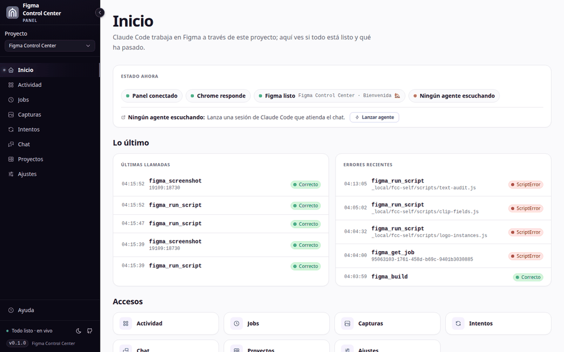
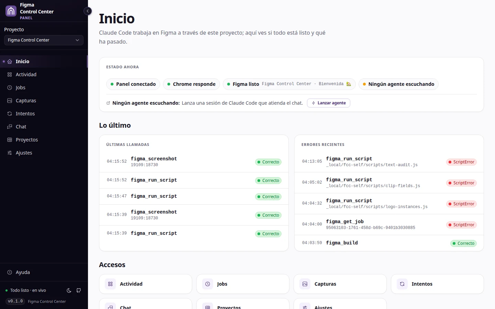
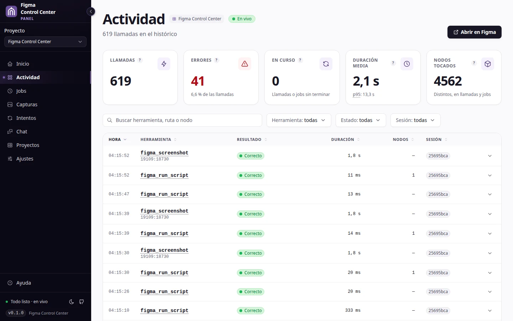
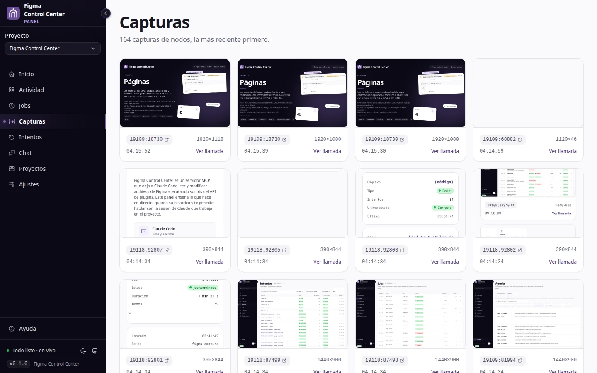
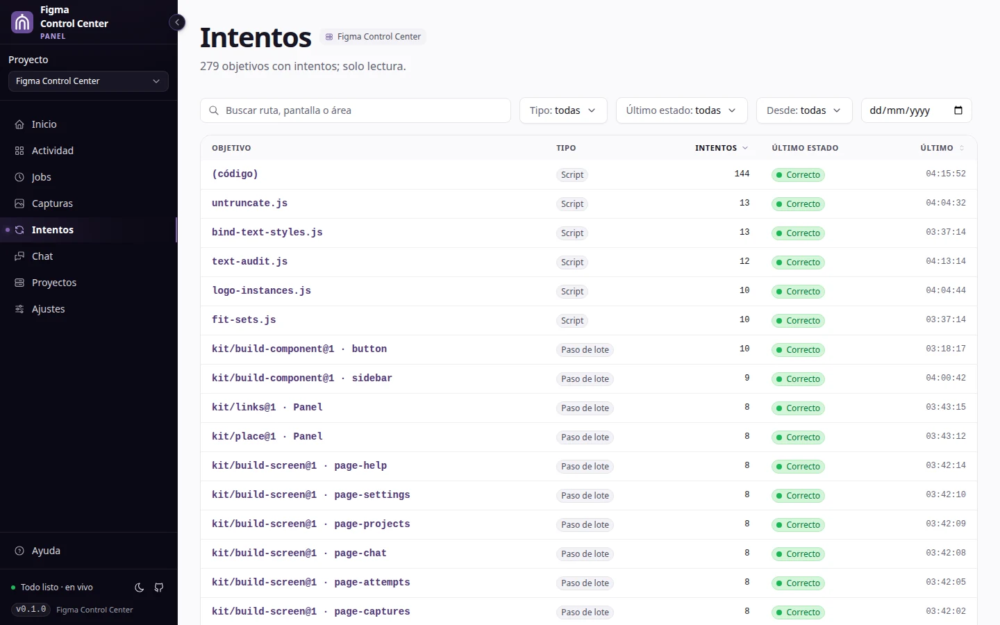
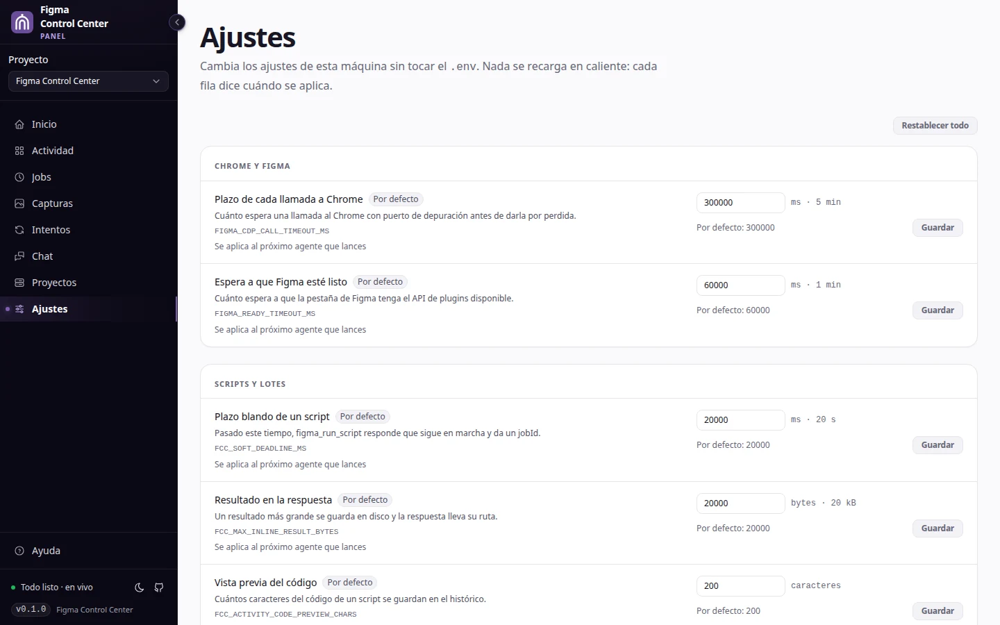

---
seo:
  title: "Local dashboard for Figma MCP calls"
  description: "Use the local dashboard of the Figma MCP server to see live tool calls, jobs and screenshots, review attempts and diffs, edit settings and chat with the agent."
---

# The dashboard

A local web page that shows, live, what the server does: every tool call, how long it took, errors
with their next step, long jobs, touched nodes (with a link into Figma) and screenshots. It is also
where projects are registered, settings edited and the agent chat lives.



The interface is in Spanish for now.

```bash
make dashboard     # builds web/ and serves it on http://127.0.0.1:4173 (FCC_DASHBOARD_PORT)
```

It is a separate process from the MCP server. It reads the same SQLite database (WAL mode), so it
survives Claude Code restarts, keeps the history, and tells several sessions apart. At start-up it
deletes history older than `FCC_HISTORY_RETENTION_DAYS`.

:::warning[Local only]
The dashboard has no authentication. It only listens on loopback (`127.0.0.1`, `localhost` or
`::1`); any other `FCC_DASHBOARD_HOST` is refused at start-up. Do not put it behind a proxy.
:::

## Pages

The view — search, filters, sort, page, open row — lives in the URL hash, so reloading keeps it and a
link shares it. The selected project travels as `?project=<number>`.

| Page | Route | What it shows |
|---|---|---|
| Home | `#/` | The day's status: dashboard, Chrome, Figma and agent as status pills, with the next step only for what is not ready; the latest calls and errors; quick access to each section |
| Activity | `#/activity` | Every call: KPIs, filters, full-text search, a sortable table with expandable rows and pagination — all computed by the database |
| Jobs | `#/jobs` | Long scripts and batches with their progress and steps |
| Captures | `#/captures` | Screenshots taken with `figma_screenshot` and `figma_design_context` (web captures and exports are not listed) |
| Attempts | `#/attempts` | The attempt history, see below |
| Chat | `#/chat` | Questions about the project's state and activity to an agent started by `make agent` (it only consults: the work is done from Claude Code in your project), permission requests, **Launch agent** / **Close agent** |
| Projects | `#/projects` | Register, edit and remove projects |
| Settings | `#/settings` | The editable settings, with their source and a reset |
| Components | `#/components` | The gallery of the dashboard's own UI components. Only with `FCC_DASHBOARD_MODE=development` ([configuration](configuration.md#dashboard-and-agent)) |
| Help | `#/help` | At the bottom of the sidebar. **How it works**: what the tool is, the flow diagram and what each section is for. **Glossary**: every code the dashboard shows, with a search box and a filter by group. The tab and the group live in the URL (`#/help?tab=glossary&group=tools`), so other pages link straight to a group; old links to the glossary on Home land here |

> [!NOTE]
> Without any project, only Home, Projects, Settings, Help and Components (in development mode) are enabled.

Home answers "is everything ready?" at a glance, and lists the latest calls and errors:



Activity is the whole record, with its KPIs, filters and a sortable table:



Captures keeps every screenshot next to the call that took it:



New events arrive over Server-Sent Events with the id of the last one seen, and resume after a
reconnection. Codes that are not self-explanatory (`ScriptError`, session ids, `p95`, node ids…)
carry a tooltip, also reachable from the keyboard, drawn from the same module as the glossary.

The sidebar footer has two lines. The first is one dot and a summary of the dashboard, Chrome and
Figma ("Todo listo · en vivo" when all three are fine, otherwise what is wrong); hover or focus it for
each one in detail. Next to it, the theme button (light by default) and a link to the repository on
GitHub. The second line is the version. With the sidebar collapsed, the dot and the buttons stack and
the summary stays in the tooltip.

## Attempts

`#/attempts` is read-only. It lists the targets — scripts, kit steps, captured screens — with their
attempts (filters by kind, last status, date and text; sort and paging on the server). A target's page
shows all its attempts and, between two of them (by default the last and the one before), the state of
each role and the line-by-line diff of one. Dates are local time. No button writes to Figma or repeats
an attempt. It is the same computation `figma_history_diff` uses.



## Settings

`#/settings` lists every editable setting, grouped, with its help text, unit and who uses it (dashboard,
agent or both), the value in effect and where it comes from: default, saved in the dashboard, or set
by the environment (read-only here). Saving or resetting applies to the next session that starts and
to the dashboard on its next start. Ports, paths, the database and the terminal command are boot
settings and only change in the `.env`. See [Configuration](configuration.md).



## Working on the UI

```bash
make dev-web       # Vite with hot reload; /api, /events and /screenshots are proxied to the dashboard
```

Leave the dashboard running next to it. How the UI is built is in the contributor docs.
