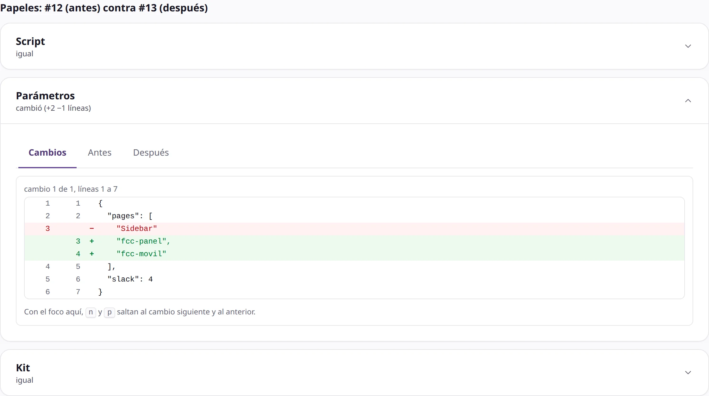

---
seo:
  title: "Kit del API de plugins de Figma"
  description: "El kit de Figma que se inyecta en la pestaña: piezas con nombre que resuelven las trampas del API de plugins, resultados step@1 y los pasos del kit."
  image:
    src: "/og-es.png"
    alt: "Logo de Figma Control Center junto al lema: un servidor MCP local que ejecuta scripts del API de plugins desde disco"
---

# El kit de Figma

Escribir en Figma con el API de plugins tiene trampas que muerden a todos los scripts igual: una página
buscada por su nombre sin recortar, una pintura ligada a una variable que pierde la opacidad sin
avisar, un nodo que cambia de id al cambiar de página, un slot relleno con una instancia cuyo texto se
editó. El **kit de Figma** (`figma-kit@1`) es el conjunto de piezas con nombre que resuelven cada
trampa una sola vez.

El servidor instala el kit en la pestaña de Figma —una vez; antes de cada script comprueba la versión
y el hash instalados, y lo reinstala si la pestaña se recargó— y se lo pasa a cada script como `kit`.
Sus fuentes viven en `kits/figma/`; el paquete que instala el servidor es `kits/dist/figma-kit.js`.

## Las piezas

| Pieza | Qué resuelve |
|---|---|
| `kit.page.find` · `ensure` · `remove` | Páginas por nombre recortado o por clave; nunca borra la página abierta sin salir antes de ella |
| `kit.node.get` · `tag` · `byKey` | Nodos por id, y por una clave guardada con `setSharedPluginData`: los ids cambian, las claves no |
| `kit.frame.ensure` · `replaceContent` | Frames por clave, creados una vez; reemplazar el contenido conserva el id del frame, así que los enlaces a él sobreviven |
| `kit.component.find` · `setNameOf` · `variant` · `cloneVariant` | El catálogo de componentes (con caché), el set de una instancia, una variante por sus props, clonar variantes |
| `kit.instance.create` | Instancias con textos y propiedades booleanas ya puestas, en la instancia anidada dueña de cada propiedad |
| `kit.slot.fill` · `share` | El contenido de un slot entra como clon; las variantes de un set comparten una sola propiedad de slot |
| `kit.fonts.ensure` · `load` | Carga lo que falte, todo junto, antes de tocar `characters`: `ensure` para las fuentes de unos nodos de texto, `load` para una lista de `{ family, style }` |
| `kit.tokens.load` · `resolver` · `paint` | Variables por nombre, del único modo de cada colección; rellenos y bordes ligados a su variable |
| `kit.paints.set` | Pinturas ligadas a variables con su opacidad repuesta |
| `kit.icons.fromSvg` | Iconos desde SVG, normalizados para que `createNodeFromSvg` los acepte |
| `kit.links.*` · `kit.flow.start` | Enlaces del prototipo por texto o por fila de tabla, guardados y repuestos al rehacer; puntos de inicio del flujo editados por nombre sin borrar los de otros |
| `kit.json` | Un asset (bytes) leído como JSON: los datos van por `assets`, nunca pegados en el script |
| `kit.track()` | Abre el seguimiento del paso en curso: las piezas que crean, cambian o borran nodos avisan ahí, y `.done(report?)` devuelve un resultado `step@1` válido |
| `kit.fail(código, mensaje, siguiente)` | Hace fallar el paso con un código y un siguiente paso; el servidor lo convierte en un `ScriptError` cuyo `nextStep` es `siguiente` |
| `kit.steps.*` | Los pasos del kit de abajo, como funciones |

El kit nunca importa código del servidor. Sus tipos salen solo de los del API de plugins.

## `step@1`: scripts cuyo resultado se juzga

Si la **primera línea** de un script es

```js
// @contract step@1 · coloca las tarjetas de la pantalla de inicio
```

su resultado tiene que cumplir [`step@1`](contracts.es.md#step1):

```json
{ "createdNodeIds": ["1:2"], "mutatedNodeIds": ["1:3"], "removedNodeIds": [], "warnings": [], "report": {} }
```

`removedNodeIds`, `warnings` y `report` son opcionales. Un resultado que no cumple falla con
`ContractError` y el puntero JSON del problema; los `warnings` acaban en el `warning` de la respuesta.
Sin la cabecera, no se juzga nada. La forma fácil de cumplir:

```js
// @contract step@1 · añade un título
const t = kit.track();
const page = await kit.page.ensure({ name: "Ejemplo", key: "ejemplo" });
await kit.fonts.load([{ family: "Inter", style: "Regular" }]);
const title = figma.createText();
page.appendChild(title);
title.characters = "Hola";
t.created(title);
return t.done();
```

## Intentos

Cada ejecución de un script deja un **intento** con el contenido exacto que usó —el script, sus
params, el kit y, en los pasos del kit, los planes y ficheros del proyecto que leyó—, así que dos
ejecuciones del mismo objetivo se pueden comparar línea a línea. Ver [Intentos](tools.es.md#intentos) y
la [página Intentos](dashboard.es.md#intentos) del panel.

Aquí, entre los intentos 12 y 13 de un script, solo cambiaron los parámetros:



## Pasos del kit

Un paso del kit es un paso de `figma_build` cuyo código viene con el kit: sin fichero de script, solo
su nombre y su objetivo. El servidor envía un código fijo que llama a
`kit.steps.<pieza>(params, assets)`, así que todo paso del kit se juzga contra `step@1`. Sus datos
salen de los ficheros de contrato del proyecto consumidor, no de ti.

| Paso | Forma en el manifiesto | Qué hace |
|---|---|---|
| `kit/place@1` | `{ "use": "kit/place@1", "area": "<nombre>" }` | Lleva una pantalla construida de su página temporal (`pagePrefix + frame`) al frame del área, conservando el id del frame (los enlaces apuntan a él). `place.mode` es `replace-content` o `transplant`; `shell` cambia la carcasa común del área por una instancia con la variante que toca |
| `kit/share@1` | `{ "use": "kit/share@1", "area": "<nombre>" }` | El contenido común a varias áreas pasa a un componente con una variante por área, y cada frame usa una instancia (`shared` de `areas@1`) |
| `kit/links@1` | `{ "use": "kit/links@1", "area": "<nombre>" }` | Enlaces del prototipo por texto o por filas de tabla, el punto de inicio del flujo y el recorte |
| `kit/fill-image@1` | `{ "use": "kit/fill-image@1", "area": "<nombre>" }` | Pone una imagen real como relleno del nodo que lleva un texto dado (p. ej. el hueco de un mapa) |
| `kit/layout-check@1` | `{ "use": "kit/layout-check@1", "area": "<nombre>" }` | Revisión de solo lectura de cada frame de primer nivel: textos que se pisan, contenedores colapsados, filas de tabla desalineadas, en `report.layout` |
| `kit/build-screen@1` | `{ "use": "kit/build-screen@1", "screen": "<clave>", "area"?, "variant"?, "capture"? }` | Pinta una pantalla desde su última captura válida de la web, con `map@1` (y `recognize@1`); antes, el servidor arma el plan `screen@1`. Con `area`, en la página temporal de esa área, lista para `kit/place@1` |
| `kit/build-component@1` | `{ "use": "kit/build-component@1", "sheet": "<clave>", "scratch"? }` | Pinta la hoja de un componente —cabecera, tarjeta y el set de variantes con su matriz y sus propiedades— desde su captura, `sheets@1` y `map@1`. Si el set existe, se rehace en su sitio (mismo id, variantes emparejadas por props). Si Figma va *por delante* de la web, no escribe nada e informa del desfase. `scratch` pinta en una página aparte |
| `kit/compose@1` | `{ "use": "kit/compose@1", "compose": "<clave>" }` | Pinta un `compose@1` solo con instancias de hojas, variables y estilos. Todo lo que nombra se resuelve antes de escribir; relanzarlo no duplica (el frame se busca por clave y se rehace) |

Todos los pasos admiten además `timeoutMs` (por defecto `FCC_BUILD_STEP_TIMEOUT_MS`).

### Planes desde áreas y hojas

Pocas veces escribirás estos pasos a mano:

- `figma_build({ areas: ["Panel"] })` arma, para cada área: `build-screen` de cada pantalla con
  captura (si el proyecto declara un `map`) → `place` → `share` (si está en un grupo compartido) →
  `links` (si tiene enlaces o punto de inicio) → `fill-image` (si tiene rellenos).
  `kit/layout-check@1` nunca se añade solo: pídelo en `steps` o en un manifiesto.
- `figma_build({ sheets: ["marca"] })` emite un `kit/build-component@1` por hoja, en el orden de
  `sheets@1`, para que las hojas anidadas vayan antes.

### Un manifiesto

```json
{
  "name": "ejemplo · panel",
  "expect": { "fileName": "Ejemplo" },
  "params": { "theme": "light" },
  "steps": [
    { "use": "kit/build-screen@1", "screen": "inicio", "area": "Panel" },
    { "use": "kit/place@1", "area": "Panel" },
    { "file": "scripts/ejemplo/tidy.js", "params": { "gap": 24 } },
    { "use": "kit/layout-check@1", "area": "Panel" }
  ]
}
```

Un paso de script lleva `file` y, opcionalmente, `format`, `params` (se mezclan sobre los del lote;
gana el paso), `assets` y `timeoutMs`. Cualquier clave que el contrato no define es un error, así que
una errata se rechaza en vez de ignorarse sin avisar. El esquema es
[`build-manifest@1`](contracts.es.md#build-manifest1).
