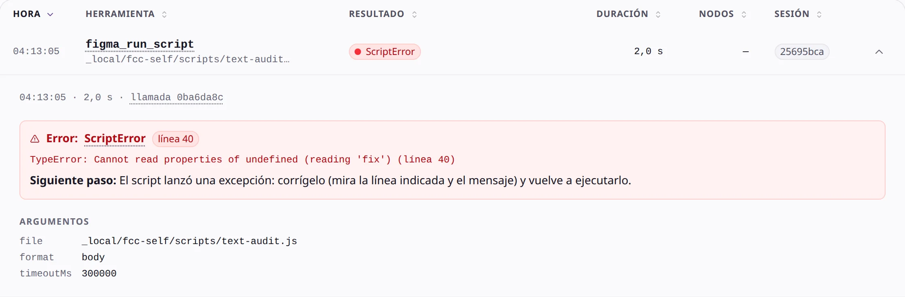
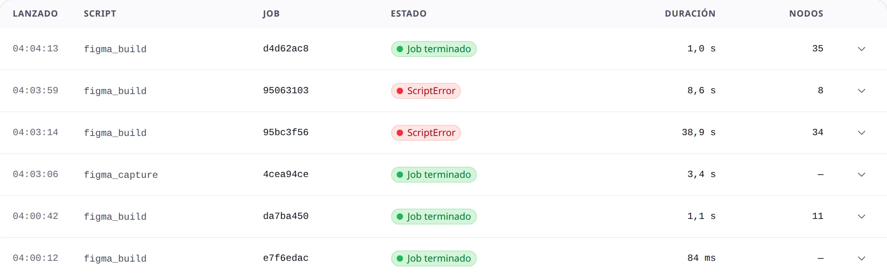

---
seo:
  title: "Herramientas MCP de Figma: referencia"
  description: "Referencia de las herramientas MCP de Figma Control Center: formato de respuesta, jobs, scripts y lotes, lecturas del catálogo, captura web e histórico."
  image:
    src: "/og-es.png"
    alt: "Logo de Figma Control Center junto al lema: un servidor MCP local que ejecuta scripts del API de plugins desde disco"
---

# Herramientas

Todas las herramientas se llaman `figma_*`, validan su entrada con zod y declaran anotaciones MCP
(`readOnlyHint`, `destructiveHint`…) para que el cliente distinga lecturas de escrituras. El esquema
completo de entrada y salida de cada una se ve en `/mcp` o con `make tools` (MCP Inspector en modo
CLI).

## El formato de respuesta

Las herramientas de Figma responden con la misma forma:

```json
{ "ok": true, "result": {}, "error": null, "touchedNodeIds": ["12:3"], "retryable": false }
```

| Campo | Qué significa |
|---|---|
| `ok` | Si la llamada hizo lo que se le pidió |
| `result` | Un valor pequeño, o `{ path, bytes }` cuando era demasiado grande (`FCC_MAX_INLINE_RESULT_BYTES`) y fue a `results/` |
| `error` | `{ type, message, nextStep, retryable, … }` o `null`. `nextStep` siempre dice qué hacer |
| `touchedNodeIds` | Todos los nodos que la llamada creó o cambió. Si la lista no cabe, `touchedPath` apunta a un fichero con todos |
| `retryable` | `false` si el fallo está en tu llamada (ruta, script, params) o es incierto (un plazo vencido: algo pudo ejecutarse). `true` si está en el entorno (Chrome, pestaña, sesión) y basta con arreglarlo |
| `tabOpened` | Solo aparece cuando el servidor abrió la pestaña del proyecto para esta llamada |

> [!TIP]
> **Los datos grandes nunca pasan por la conversación.** Los scripts se pasan por ruta, las lecturas van
> a ficheros y la respuesta trae la ruta y un resumen pequeño. Lee el fichero cuando necesites el
> detalle.

En el panel, una llamada fallida se abre con su tipo de error, el mensaje y el siguiente paso:



## Jobs

Una llamada que pasa del plazo blando (`FCC_SOFT_DEADLINE_MS`) responde `status: "running"` con un
`jobId`. Síguela con `figma_get_job`.

- Los jobs viven en memoria: un reinicio del servidor los pierde.
- Un lote a la vez por archivo de Figma, entre sesiones (ficheros de bloqueo en `FCC_LOCK_DIR`).
  Mientras corre un lote, otro `figma_build` o `figma_run_script` se rechaza; las lecturas siguen
  funcionando y pueden ver una pantalla a medio construir.

> [!WARNING]
> Un script que ya corre en la pestaña de Figma **no se puede interrumpir**: Figma no ofrece cómo. Si
> el cliente se va a mitad, el job acaba `Interrupted` y el script pudo seguir. Para algo largo,
> trocéalo en pasos con `figma_build`, que se puede cancelar entre pasos y dice dónde se paró.

La página **Jobs** del panel los lista con su estado:



## Figma

### `figma_status`

Diagnóstico, y lo primero a lo que llamar cuando otra herramienta falla: si Chrome responde, si la
pestaña del proyecto está abierta (la abre si no), si `figma` está listo, qué archivo y qué página. Si
falla, el error y el siguiente paso. `previousScriptRunning` vale `true` cuando un script que pasó de su
plazo sigue corriendo en la pestaña: las escrituras se rechazan hasta que acabe o se recargue la
pestaña.

### `figma_run_script`

Ejecuta un script del API de plugins en el archivo abierto.

| Entrada | |
|---|---|
| `file` | Ruta del script, dentro de las raíces de scripts del proyecto. Úsala para todo lo que no sea una línea: el contenido nunca pasa por la conversación |
| `code` | Código en línea, solo para fragmentos cortos. Exactamente uno de `file` o `code` |
| `format` | `body` (por defecto): el cuerpo de una función async, con `await` y `return`. `function`: un `async (params, assets, kit) => { … }` completo |
| `params` | Un valor JSON pequeño que el script recibe como `params` (`FCC_MAX_PARAMS_BYTES`) |
| `assets` | `{ nombre: ruta }` de ficheros binarios; llegan como `Uint8Array` en `assets[nombre]` (`FCC_MAX_ASSET_BYTES`) |
| `resultFile` | Un nombre de fichero sin ruta: el `result` va siempre a `results/<resultFile>`, aunque sea pequeño, y se pisa |
| `timeoutMs` | Plazo de la llamada a Chrome (por defecto `FIGMA_CDP_CALL_TIMEOUT_MS`) |

El script declara lo que tocó en su valor de retorno —
`return { createdNodeIds: ["1:2"], mutatedNodeIds: ["1:3"] }`— o la respuesta trae un `warning`.
Un script que solo lee declara listas vacías (`createdNodeIds: []`): eso cuenta como declaración y no hay `warning`.
También recibe `kit`, el [kit de Figma](kit.es.md); con `// @contract step@1 · <qué hace>` en su
primera línea, su resultado se juzga contra [`step@1`](contracts.es.md#step1).

### `figma_build`

Ejecuta un lote: una lista de pasos, cada uno un script o un [paso del kit](kit.es.md#pasos-del-kit).
Exactamente uno de:

| Entrada | |
|---|---|
| `manifest` | Ruta a un JSON [`build-manifest@1`](contracts.es.md#build-manifest1); lo normal: versionable y relanzable |
| `steps` | Una lista corta escrita en línea, con las mismas formas de paso que el manifiesto |
| `areas` | Nombres de áreas de `areas@1`: el servidor arma el plan de cada una sin manifiesto |
| `sheets` | Claves de hojas de `sheets@1`: un `kit/build-component@1` por hoja, en el orden del fichero (las anidadas, antes) |

Además, `fromStep` (reanudar: los pasos anteriores salen `skipped`), `stopOnError` (por defecto
`true`), `params` (comunes a todos los pasos; cada paso puede sobrescribirlos) y
`expect: { fileName }`, una guarda: si el archivo abierto no se llama así, el lote se rechaza antes de
enviar nada, también al reanudar.

Responde en cuanto acepta el lote, con `status: "running"`, el `jobId` y el plan entero en `steps`. Un
error de validación (ruta, manifiesto, script, asset, params, un `compose@1` que nombra algo que no
existe) llega en esa misma respuesta, sin job y sin tocar Figma. El resultado de cada paso no viaja en
la respuesta: está en el histórico (`figma_history_call`). Con `sheets`, una hoja sin captura válida no
tiene paso y sale en `skippedSheets` con `NO_SOURCE`.

### `figma_get_job`

Estado y resultado de un job que dejó en marcha `figma_run_script`, `figma_build`, una lectura o
`figma_capture`. Con `waitMs`, espera a que termine (con el plazo blando como tope) y emite
notificaciones de progreso MCP si el cliente mandó un token de progreso. Un lote añade
`kind: "build"`, `progress` (`done`, `total`, `cancelled`, `skipped`, `current`) y `steps`.

### `figma_cancel_job`

Cancela un lote entre pasos: el paso en curso termina y los siguientes no se envían. Responde al
momento con el progreso real y `cancelRequested: true` si no había acabado; el final se sigue con
`figma_get_job`. No para un `figma_run_script`.

### `figma_screenshot`

PNG de un nodo (`nodeId`, `scale` hasta 4) guardado en
`<salida>/screenshots/<AAAA-MM-DD>/<nodo>_<HHMMSS>.png` en hora local (`-2`, `-3`… si ya existe).
Devuelve la ruta y el tamaño; la imagen no pasa por la conversación. Sale en la página Capturas del
panel.

### `figma_metadata`

Un árbol ligero de capas `{ id, name, type, children? }` de un nodo (por defecto, la página actual)
hasta `depth` niveles. Úsala para localizar ids antes de escribir o capturar.

## Lecturas del catálogo

Solo lectura, nunca tocan un nodo. Cada una escribe su JSON completo en `reads/` y responde con
`path`, un `summary` con conteos y el `jobId` de su job: toda lectura corre como job, así que una larga
devuelve `running`. Funcionan con un lote en marcha.

| Herramienta | Lee | Entradas |
|---|---|---|
| `figma_variables` | Colecciones de variables locales: modos, valores por modo, alias | `collection`, o `nodeId` para solo las variables ligadas en ese subárbol y dónde (`bindings`) |
| `figma_styles` | Estilos locales de pintura, texto, efecto y retícula, con sus variables y un valor corto | `kind` |
| `figma_components` | Sets de componentes con las opciones de cada variante y las propiedades que no son variante, y componentes sueltos | `page`, `query` |
| `figma_instances` | Instancias por frame de primer nivel, contadas por nombre de set o de componente | `pages` (obligatoria), `frame` |
| `figma_export` | Nodos a PNG, JPG, SVG o PDF: un fichero por nodo en `exports/` y el índice en `reads/` | `nodeIds` (hasta `FIGMA_EXPORT_MAX_NODES`), `format`, `scale` |
| `figma_design_context` | Un nodo como [`design-context@1`](contracts.es.md#design-context1), para escribir su plantilla | ver abajo |

### `figma_design_context`

De diseño a código. Lee un frame, una instancia o un set de componentes y deja su contexto en
`reads/`: el árbol en anchura con auto-layout, rellenos, bordes, radios, texto y estilos. Cada valor
ligado sale como su variable resuelta (nombre, colección, valor en el modo por defecto) o su estilo;
cada valor sin ligar sale en `unmapped`: o falta un token, o el diseño se salió del sistema. Una
instancia lleva su componente, su variante, sus propiedades y lo que cambió, sin bajar dentro salvo en
sus huecos. Cada componente lleva su hoja y su plantilla (`code.source`, `code.tag`) o, si no la tiene,
el aviso `NO_CODE_MAPPING` con candidatas.

| Entrada | |
|---|---|
| `nodeId` | El nodo que se lee |
| `variant` | Solo para un set: `{ propiedad: opción }` de la variante que se recorre (por defecto, la del set) |
| `maxNodes` | Tope de nodos (por defecto `FIGMA_DESIGN_CONTEXT_MAX_NODES`); lo demás sale en `truncated` |
| `screenshot` | Saca también la captura del nodo, el objetivo visual (por defecto `true`; `false` en lotes de nodos) |

No genera código ni escribe nada en el proyecto consumidor. Ver [Flujos de trabajo](workflows.es.md#de-figma-a-código).

## Captura de la web

### `figma_capture`

Captura pantallas de la **web** del proyecto —las claves de su `screens@1`— en un Chrome sin ventana
aparte, nunca el de Figma. No toca ningún nodo de Figma.

Lee `figma-control-center.json`, entra por el formulario de login con el usuario de la pantalla si lo
pide (contraseña de `FCC_WEB_SECRETS_FILE`) y juzga cada captura contra `capture@1`: la válida va a
`web-captures/<día>/` y la que no cumple, a `rejected/` con sus errores. La respuesta trae las rutas,
una línea de `summary` por pantalla y como mucho `FCC_CONTRACT_INLINE_ERRORS` errores: el árbol se
lee del fichero. Las pantallas con `evaluateInPage` (código en el mundo de la propia página) piden
`allowPageWorld: true`. Una captura a la vez en la máquina.

## Historial

Todo lo que hacen las herramientas queda en SQLite, en la base única, con el número del proyecto en
cada fila: un servidor solo ve el histórico de su proyecto. Consultar el histórico no deja rastro.

La regla es **primero el agregado, después el detalle por id**: empieza por el resumen y luego pide una
llamada. Toda lista devuelve `total` y `truncated` (tope: `FCC_HISTORY_MAX_ROWS`). El rango se da con
`preset` (`last_hour`, `today`), `since`/`until` (ISO 8601) o `sessionId`, más `limit`.

| Herramienta | Devuelve |
|---|---|
| `figma_history_summary` | Llamadas, escrituras en Figma, errores, en curso, duración media y p95, jobs, nodos tocados, herramientas más usadas |
| `figma_history_errors` | Errores agrupados por tipo, con el siguiente paso y hasta tres ejemplos (los jobs fallidos cuentan) |
| `figma_history_nodes` | Nodos tocados: cuántas llamadas tocaron cada uno, y la última |
| `figma_history_sessions` | Sesiones del servidor (una por sesión de Claude Code) con sus contadores |
| `figma_history_search` | Llamadas que coinciden con `query` (texto completo: ruta del script, herramienta, texto de error o id de nodo), con una frase resumen |
| `figma_history_call` | Una llamada por `callId`: argumentos, resultado, error, nodos, job, capturas, intentos. En un lote, un extracto corto del resultado de cada paso; `step` devuelve el resultado entero de uno |

### Intentos

Cada ejecución —un `figma_run_script`, cada paso de un lote que corre, cada pantalla de un
`figma_capture`— deja un **intento** con el contenido exacto que usó (script, params, kit, ganchos,
pantallas…), sin repetir contenidos iguales y enlazado a su llamada. Responde a «¿qué cambió entre la
vez que funcionó y la que no?».

| Herramienta | Devuelve |
|---|---|
| `figma_history_attempts` | Sin `target`: los objetivos (ruta del script relativa a su raíz, `(código)` para código en línea, o clave de pantalla) con su número de intentos y el último estado. Con `target`: sus intentos en orden, con estado, primer error, llamada, kit y **qué papeles cambiaron** respecto al anterior. Filtros: `kind` (`run_script`, `build_step`, `capture`), `since` |
| `figma_history_script` | Escribe el contenido exacto de un papel de un intento (`attempt` + `role`, o un `sha256`) en `history-scripts/<sha256>.<js\|json>` y devuelve su `path`. Un contenido por encima de `FCC_SCRIPT_MAX_BYTES` solo se guardó como hash, y lo dice |
| `figma_history_diff` | Compara dos intentos del mismo objetivo (`from`, `to`): el estado de cada papel con las líneas añadidas y quitadas, los assets que cambian y el diff unificado de un papel (`role`, o el primero que cambió), recortado a `FCC_HISTORY_DIFF_INLINE_LINES` en la respuesta y entero en `history-diffs/`. Los papeles JSON se comparan formateados y con las claves ordenadas |

> [!NOTE]
> El servidor **nunca guarda el contenido de un script en el registro de actividad**: solo su ruta, o la
> longitud y los primeros caracteres de un `code`. El contenido de los intentos es la excepción, a
> propósito, y sigue la retención del histórico.

## Chat

### `figma_chat_reply`

La respuesta de Claude a un mensaje que llegó del panel como etiqueta `<channel>`: el `chat_id` de esa
etiqueta y el `text`. Solo tiene sentido en una sesión arrancada con `make agent`; ver
[Usarlo desde Claude Code](claude-code.es.md#el-chat-del-panel).

## Prompts

Los prompts del histórico (`last-hour`, `errors-today`, …) están en
[Usarlo desde Claude Code](claude-code.es.md#prompts).
