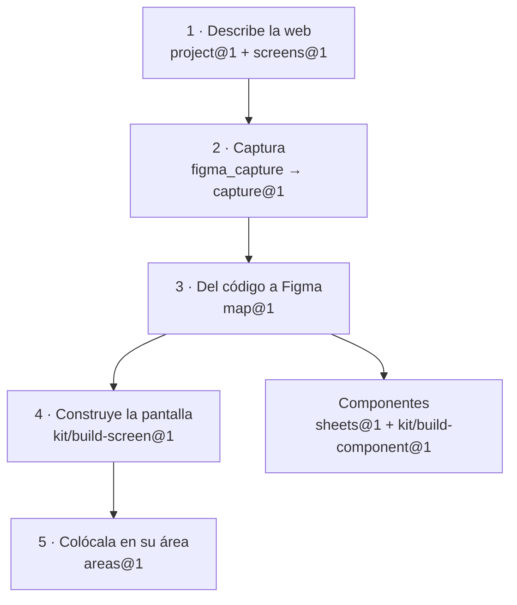
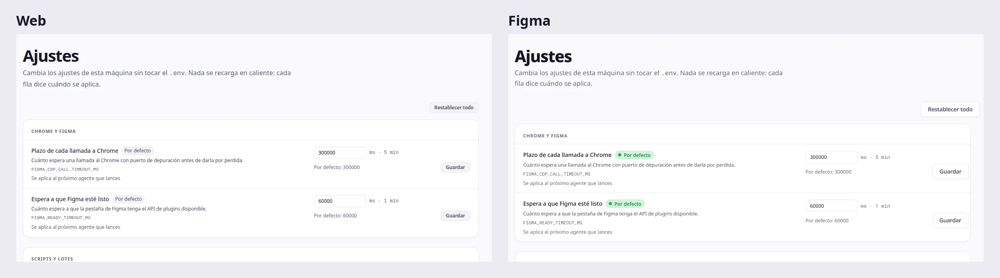

---
seo:
  title: "De Figma a código y de web a Figma"
  description: "Flujos paso a paso con Claude Code y las herramientas MCP de Figma: de la web a Figma, de Figma a código y diseño sin web con mapas, hojas y compose@1."
  image:
    src: "/og-es.png"
    alt: "Logo de Figma Control Center junto al lema: un servidor MCP local que ejecuta scripts del API de plugins desde disco"
---

# Flujos de trabajo

Tres direcciones, todas llevadas desde Claude Code con las herramientas de
[Herramientas](tools.es.md). La herramienta pone la mecánica y los contratos; cómo *debe* ser el
diseño lo decidís tú y el agente.

Los ejemplos usan el proyecto `ejemplo`, con la forma del fixture de tests
`server/test/fixtures/projects/example-mini/`.

## De la web a Figma

Tienes una web en marcha y quieres sus pantallas y componentes en Figma, construidos con tus
variables, estilos y sets de componentes en vez de rectángulos sueltos.



### 1. Describe la web: `project@1` y `screens@1`

En el directorio del proyecto, `figma-control-center.json` da la URL base, el viewport y el formulario
de login (ver [Configuración](configuration.es.md#el-proyecto-consumidor-figma-control-centerjson)), y
`screens.json` lista qué se captura:

```json
{
  "contract": "screens@1",
  "screens": [
    { "key": "inicio", "title": "Inicio", "url": "/" },
    { "key": "privado", "title": "Privado", "url": "/privado/", "session": "lector" },
    {
      "key": "menu-abierto", "title": "Menú abierto", "url": "/", "pick": "header",
      "variants": [
        { "props": { "menu": "abierto" }, "run": [{ "click": "#abrir-menu" }],
          "until": "document.getElementById('menu').offsetHeight > 0" }
      ]
    }
  ]
}
```

Una pantalla puede entrar como un usuario (`session`), quedarse con un solo elemento (`pick`), cambiar
el viewport y declarar **variantes**: parámetros de la URL, clics, estados CSS forzados (`force`) o,
con `allowPageWorld`, código evaluado en la página (`evaluateInPage`), más una condición `until` que
esperar.

### 2. Captura: `figma_capture`

```text
figma_capture({ screens: ["inicio", "menu-abierto"] })
```

Cada pantalla se captura en un Chrome sin ventana aparte y se juzga contra `capture@1`: el árbol del
DOM con su disposición, estilos calculados, textos e imágenes por referencia, una entrada por
variante. Las capturas válidas van a `web-captures/<día>/` de la carpeta de salida del proyecto; las
que no, a `rejected/` con cada error y el id y la ruta del nodo donde está. Figma no se toca.

### 3. Del código a Figma: `map@1`

`map.json` le dice al pintor cómo traducir: qué prefijos de clase son colores de fondo, de texto o de
borde, cómo un nombre de clase se convierte en nombre de variable, qué fuentes y estilos usar, cómo
pasan las sombras a efectos, dónde está el catálogo de iconos, cómo se llaman las capas de cada
elemento HTML y las huellas que sirven para reconocer componentes dentro de una captura.
`recognize.js` puede añadir reglas del proyecto que convierten un nodo capturado en una instancia de un
set con su variante y sus props.

### 4. Construye la pantalla: `kit/build-screen@1`

```text
figma_build({ steps: [{ use: "kit/build-screen@1", screen: "inicio" }] })
```

El servidor convierte la última captura válida en un plan `screen@1` (en `screen-plans/`) y el kit lo
pinta: frames con auto-layout, rellenos y bordes ligados a variables, estilos de texto, componentes
reconocidos como instancias. Lo que no tiene variable se informa, no se inventa.

La página de Ajustes del propio panel, en el navegador y pintada en Figma a partir de una captura:



### 5. Colócala en su área: `areas@1`

`areas.json` describe las áreas del archivo: la página, el tamaño del frame, cómo se coloca una
pantalla construida, la carcasa común a las pantallas del área, los enlaces del prototipo y los
rellenos de imagen. Después:

```text
figma_build({ areas: ["Panel"] })
```

construye cada pantalla del área que tenga captura, la coloca en su frame (conservando el id del
frame, así que los enlaces sobreviven), comparte el contenido común entre áreas, cablea los enlaces del
prototipo y rellena las imágenes. Añade `{ use: "kit/layout-check@1", area: "Panel" }` para revisar
después textos que se pisan y contenedores colapsados.

### Componentes: `sheets@1` y `kit/build-component@1`

Para la librería de componentes, `sheets.json` da una hoja por componente: la pantalla capturada que
lo muestra (normalmente una página de galería con una variante por query string), la matriz de
propiedades, los textos que pasan a propiedades de texto y el fichero de plantilla del que sale
(`source`).

```text
figma_build({ sheets: ["marca"] })
```

pinta cada hoja como una página con una cabecera, una tarjeta de descripción y el set del componente
con su matriz de variantes. Una hoja que ya existe se rehace sobre el mismo set, así que las
instancias de otros sitios siguen funcionando. Si alguien editó el set en Figma más allá de lo que
enseña la web, el paso no escribe nada e informa del desfase para que decida una persona.

## De Figma a código

Tienes un diseño en Figma —una pantalla nueva, un componente que cambió— y quieres que la plantilla
quede igual, uno a uno.

```text
figma_design_context({ nodeId: "10:1" })
```

deja en `reads/` un fichero `design-context@1` y una captura del nodo, el objetivo visual. El contexto
son datos, no código:

- el árbol, en anchura, con auto-layout, rellenos, bordes, radios, texto y estilos;
- cada valor ligado como su **variable resuelta** (nombre, colección, valor) o su estilo: usa el token,
  no el número;
- `unmapped`: los valores que no están ligados a nada. O falta un token o el diseño se salió del
  sistema; en los dos casos merece la pena levantarlo antes que fijarlo a mano;
- cada instancia con su componente, su variante, sus propiedades y lo que cambió, sin bajar dentro
  salvo por sus huecos;
- cada componente con su hoja y su plantilla (`code.source`, la ruta `source` de `sheets@1`) o el
  aviso **`NO_CODE_MAPPING`** con candidatas, si ninguna hoja lo cubre;
- `hints.classes`: las clases que `map@1` sabe escribir para cada nodo;
- `origin`: si el frame viene de un área, de una pantalla, de una hoja o de un `compose@1`.

Después, el agente edita la plantilla en el proyecto consumidor. `figma_design_context` no escribe
código ni nada en ese proyecto. Para un set de componentes, `variant` elige qué variante recorrer.

## Diseñar sin web: `compose@1`

Una pantalla que aún no existe se puede diseñar directamente en Figma, pero solo con lo que el sistema
ya tiene: instancias de hojas, variables y estilos. Esa es la gracia: nada de números ni colores
sueltos.

`compose/card.json`:

```json
{
  "contract": "compose@1",
  "key": "card",
  "title": "Ficha de ejemplo",
  "target": { "page": "Pruebas", "width": 480 },
  "root": {
    "stack": "VERTICAL",
    "gap": "espacio/m",
    "padding": "espacio/m",
    "fill": "color/fondo",
    "children": [
      { "text": "Hola", "style": "Título/L", "color": "gris/900" },
      { "use": "marca", "variant": { "tamano": "sm" }, "props": { "etiqueta": "Marca de ejemplo" } }
    ]
  }
}
```

Un bloque es una **pila** (dirección, `gap`, `padding`, `fill`, `radius`, `sizing`, hijos), una
**instancia** de una hoja (`use`, `variant`, `props`, `slots`), un **texto** (`text`, `style`,
`color`), una **imagen** de la carpeta del proyecto o un **icono** del catálogo de `map@1`. Todo valor
que no es texto nombra una variable o un estilo.

```text
figma_build({ steps: [{ use: "kit/compose@1", compose: "card" }] })
```

El compose se valida antes de tocar Figma: primero sin Figma (forma, ningún número suelto) y después
contra el archivo abierto (la hoja existe, la variante y las props existen en su set, cada token es una
variable o un estilo del tipo que toca). Si falta algo, se rechaza el lote entero con punteros JSON a lo
que falla. Relanzarlo rehace el mismo frame (se busca por su clave), así que nunca duplica.

Cuando la pantalla esté bien en Figma, [De Figma a código](#de-figma-a-código) la lleva a la
plantilla.
