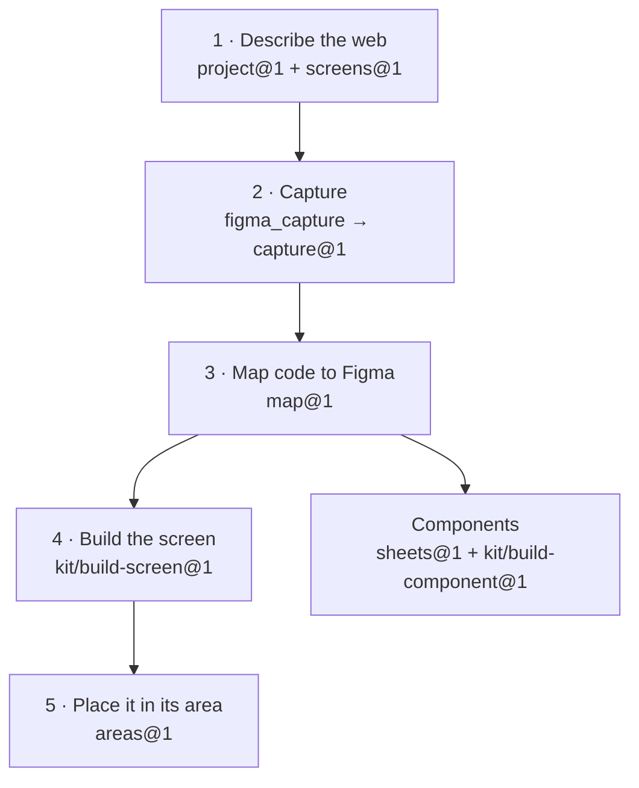
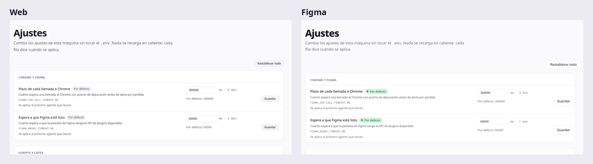

---
seo:
  title: "Figma to code and web to Figma"
  description: "Step-by-step workflows with Claude Code and the Figma MCP tools: web to Figma, Figma to code, and designing without a web through maps, sheets and compose@1."
---

# Workflows

Three directions, all driven by Claude Code with the tools in [Tools](tools.md). The tool supplies
the mechanics and the contracts; what the design *should* be is decided by you and the agent.

The examples use the project `ejemplo`, shaped like the test fixture
`server/test/fixtures/projects/example-mini/`.

## Web to Figma

You have a running web and want its screens and components in Figma, built with your variables,
styles and component sets instead of loose rectangles.



### 1. Describe the web — `project@1` and `screens@1`

In the project directory, `figma-control-center.json` gives the base URL, viewport and login form
(see [Configuration](configuration.md#the-consumer-project-figma-control-centerjson)), and
`screens.json` lists what to capture:

```json
{
  "contract": "screens@1",
  "screens": [
    { "key": "inicio", "title": "Inicio", "url": "/" },
    { "key": "privado", "title": "Privado", "url": "/privado/", "session": "lector" },
    {
      "key": "menu-abierto", "title": "Menú abierto", "url": "/", "pick": "header",
      "variants": [
        { "props": { "menu": "abierto" }, "run": [{ "click": "#abrir-menu" }],
          "until": "document.getElementById('menu').offsetHeight > 0" }
      ]
    }
  ]
}
```

A screen can sign in as a user (`session`), keep only one element (`pick`), override the viewport, and
declare **variants**: query parameters, clicks, forced CSS states (`force`) or, with
`allowPageWorld`, code evaluated in the page (`evaluateInPage`), plus an `until` condition to wait for.

### 2. Capture — `figma_capture`

```text
figma_capture({ screens: ["inicio", "menu-abierto"] })
```

Each screen is captured in a separate headless Chrome and checked against `capture@1`: the DOM tree
with layout, computed styles, texts and images by reference, one entry per variant. Valid captures go
to `web-captures/<day>/` in the project's output folder; invalid ones to `rejected/` with every error
and the id and path of the node where it is. Figma is not touched.

### 3. Map code to Figma — `map@1`

`map.json` tells the painter how to translate: which class prefixes are colours, text colours or
borders, how a class name becomes a variable name, which fonts and styles to use, how shadows map to
effects, where the icon catalog is, how HTML elements name their layers, and the component
fingerprints used to recognise components inside a capture. `recognize.js` can add project rules
that turn a captured node into an instance of a set with its variant and props.

### 4. Build the screen — `kit/build-screen@1`

```text
figma_build({ steps: [{ use: "kit/build-screen@1", screen: "inicio" }] })
```

The server turns the latest valid capture into a `screen@1` plan (in `screen-plans/`) and the kit
paints it: frames with auto-layout, fills and strokes bound to variables, text styles, recognised
components as instances. Anything without a variable is reported, not invented.

The dashboard's own Settings page, in the browser and painted in Figma from a capture:



### 5. Place it in its area — `areas@1`

`areas.json` describes the file's areas: the page, the frame size, how a built screen is placed, the
shell shared by every screen of the area, prototype links and image fills. Then:

```text
figma_build({ areas: ["Panel"] })
```

builds every screen of the area with a capture, places each into its frame (keeping the frame's id,
so links survive), shares common content between areas, wires the prototype links and fills the
images. Add `{ use: "kit/layout-check@1", area: "Panel" }` to review overlapping texts and collapsed
containers afterwards.

### Components — `sheets@1` and `kit/build-component@1`

For the component library, `sheets.json` gives one sheet per component: the captured screen that
shows it (usually a gallery page with one variant per query string), the property matrix, the texts
that become text properties, and the template file it comes from (`source`).

```text
figma_build({ sheets: ["marca"] })
```

paints each sheet as a page with a header, a description card and the component set with its variant
matrix. A sheet that exists is rebuilt over the same set, so instances elsewhere keep working. If
someone edited the set in Figma beyond what the web shows, the step writes nothing and reports the
drift for a person to decide.

## Figma to code

You have a design in Figma — a new screen, a changed component — and want the template to match it
one to one.

```text
figma_design_context({ nodeId: "10:1" })
```

writes a `design-context@1` file to `reads/` and a screenshot of the node, the visual target. The
context is data, not code:

- the tree, breadth-first, with auto-layout, fills, strokes, radii, text and styles;
- every bound value as its **resolved variable** (name, collection, value) or style — use the token,
  not the number;
- `unmapped`: values bound to nothing. Either a token is missing, or the design left the system;
  both are worth raising rather than hard-coding;
- every instance with its component, variant, properties and overrides, without descending into it
  except through its slots;
- every component with its sheet and template (`code.source`, the `source` path from `sheets@1`) —
  or the warning **`NO_CODE_MAPPING`** with candidates, when no sheet maps it;
- `hints.classes`: the classes `map@1` knows how to write for each node;
- `origin`: whether the frame came from an area, a screen, a sheet or a `compose@1`.

The agent then edits the template in the consumer project. `figma_design_context` itself writes no
code and nothing in that project. For a component set, `variant` picks which variant to walk.

## Designing without a web: `compose@1`

A screen that does not exist yet can be designed directly in Figma, but only from what the system
already has: instances of sheets, variables and styles. That is the point — no loose numbers or
colours.

`compose/card.json`:

```json
{
  "contract": "compose@1",
  "key": "card",
  "title": "Ficha de ejemplo",
  "target": { "page": "Pruebas", "width": 480 },
  "root": {
    "stack": "VERTICAL",
    "gap": "espacio/m",
    "padding": "espacio/m",
    "fill": "color/fondo",
    "children": [
      { "text": "Hola", "style": "Título/L", "color": "gris/900" },
      { "use": "marca", "variant": { "tamano": "sm" }, "props": { "etiqueta": "Marca de ejemplo" } }
    ]
  }
}
```

A block is a **stack** (direction, `gap`, `padding`, `fill`, `radius`, `sizing`, children), an
**instance** of a sheet (`use`, `variant`, `props`, `slots`), a **text** (`text`, `style`, `color`),
an **image** from the project folder, or an **icon** from the `map@1` catalog. Every value that is
not text names a variable or a style.

```text
figma_build({ steps: [{ use: "kit/compose@1", compose: "card" }] })
```

The compose is validated before Figma is touched — first without Figma (shape, no loose numbers),
then against the open file (the sheet exists, the variant and props exist on its set, each token is a
variable or style of the right type). Anything missing rejects the whole batch with JSON pointers to
the culprits. Running it again rebuilds the same frame (found by its key), so it never duplicates.

Once the screen is right in Figma, [Figma to code](#figma-to-code) takes it to the template.
